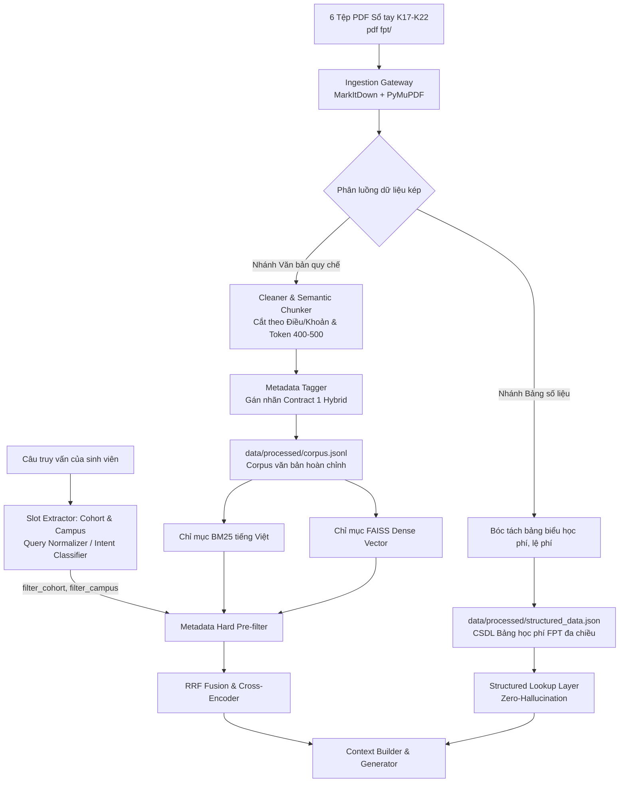

# 📋 KẾ HOẠCH TỔNG THỂ & BẢNG PHÂN RÃ NHIỆM VỤ (Plan.md)

> **Dự án**: FPTUniQA - Hệ thống Hỏi Đáp Đại Học Tiếng Việt Nhận Biết Ngữ Cảnh  
> **Nguồn dữ liệu mới**: 6 tệp PDF Sổ tay sinh viên & Quy định tài chính các khóa K17, K18, K19, K20, K21, K22 tại thư mục `pdf fpt/`  
> **Phiên bản kế hoạch**: 1.2.0 (Actionable Task Tracking Breakdown)  
> **Ngày cập nhật**: 18/10/2026  

---

## 1. MỤC TIÊU VÀ PHẠM VI DỰ ÁN

1. **Mục tiêu chính**:
   - Thay thế toàn bộ dữ liệu mẫu (mock corpus gồm 5 tài liệu) bằng kho tri thức học vụ thực tế từ 6 file PDF Sổ tay sinh viên Đại học FPT (K17 - K22).
   - Hiện thực hóa trọn vẹn kiến trúc **Dual-Path Data Pipeline** (theo Báo cáo 2 & 3): Tách biệt văn bản quy chế (nạp vào `corpus.jsonl`) và bảng số học tài chính/học phí (nạp vào `structured_data.json`).
   - Cập nhật định dạng Metadata sang **Contract 1 Hybrid** (hỗ trợ `applies_to_cohort`, `campus`, `effective_date`, `doc_type`), đảm bảo tương thích ngược 100% với toàn bộ pipeline hiện tại.
   - Hiện thực hóa bộ đôi kiến trúc cốt lõi: **Slot Extractor tại Tầng Query** $\rightarrow$ **Metadata Hard Pre-filtering tại Tầng Retrieval**, triệt tiêu nguy cơ trôi niên khóa giữa các khóa K17 - K22.
   - Thiết lập **Ma trận Đánh giá Thực nghiệm Ablation 6 cấu hình (A1 $\rightarrow$ A6)** và mở rộng bộ benchmark (~30 câu hỏi thực tế FPT) theo chuẩn nghiên cứu khoa học.

2. **Phạm vi dữ liệu đầu vào (`pdf fpt/`)**:
   - `[studocu.com] - Sổ Tay Sinh Viên K17 - Đại Học FPT - Hướng Dẫn Chi Tiết Và Thông Tin.pdf` (~101.5 MB): Toàn diện quy chế K17.
   - `sotaysinhvienK18HN.pdf` (~10.4 MB): Sổ tay sinh viên K18 cơ sở Hà Nội.
   - `[studocu.com] - Hướng dẫn Tài chính Sinh viên K19 - Quy định và Phí năm học 2023-2024.pdf` (~190 KB): Chi tiết học phí, phí thi lại, học lại, ký túc xá K19.
   - `1054154482-K20-Sổ-Tay-Sinh-Vien-2.pdf` (~12.4 MB): Quy chế học vụ, rèn luyện, OJT, chuyển ngành K20.
   - `970569429-So-Tay-Sinh-Vien-K21-FUHL-1.pdf` (~2.0 MB): Sổ tay sinh viên K21 campus Hòa Lạc.
   - `2026_So-tay-k22_compressed.pdf` (~4.4 MB): Sổ tay K22 niên giám 2026 (biểu phí mới, tiếng Anh dự bị, quy chế cập nhật).

---

## 2. KIẾN TRÚC DỮ LIỆU & QUY CHUẨN HỢP ĐỒNG (CONTRACTS)



### 2.1. Quy chuẩn Schema `corpus.jsonl` (Contract 1 Hybrid)
```json
{
  "id": "doc_fpt_k19_0042",
  "doc_id": "doc_fpt_k19_0042",
  "title": "Quy định tài chính K19 - Học phí chuyên ngành và lệ phí học lại",
  "text": "Nội dung điều khoản chi tiết...",
  "source": "Hướng dẫn Tài chính Sinh viên K19",
  "effective_date": "2023-09-01",
  "applies_to_cohort": ["K19"],
  "campus": "ALL",
  "doc_type": "finance_regulation",
  "metadata": {
    "doc_id": "doc_fpt_k19_0042",
    "section": "Mục 2: Lệ phí học lại và thi lại",
    "cohort": "K19",
    "campus": "ALL",
    "effective_date": "2023-09-01",
    "category": "hoc_phi"
  }
}
```

### 2.2. Schema Dữ Liệu Bảng Cấu Trúc ĐH FPT (`structured_data.json`)
```json
{
  "academic_years": ["2023-2024", "2024-2025", "2025-2026"],
  "tuition_table": [
    {
      "cohort": "K19",
      "campus": "HN",
      "program": "Kỹ thuật phần mềm",
      "prep_english_per_level_vnd": 11300000,
      "prep_english_levels": 6,
      "specialized_term_tuition_vnd": 28700000,
      "total_specialized_terms": 9,
      "ojt_term_tuition_vnd": 0,
      "retake_exam_fee_vnd": 300000,
      "relearn_per_credit_vnd": 650000
    }
  ],
  "dormitory_fees": [
    {
      "campus": "FUHL",
      "room_type": "Phòng 4 người",
      "fee_per_term_vnd": 4000000
    }
  ]
}
```

---

## 3. BẢNG PHÂN RÃ NHIỆM VỤ CHI TIẾT THEO TỪNG PHA (TASK BREAKDOWN)

### 🟢 PHA 1: CHUẨN BỊ MÔI TRƯỜNG & SAO LƯU AN TOÀN
- [x] **Task 1.1: Tạo thư mục sao lưu và backup toàn bộ dữ liệu hiện tại**
  - **Mục tiêu**: Lưu trữ an toàn `data/processed/` và `data/evaluation/` để có thể rollback bất kỳ lúc nào.
  - **Hành động**: Tạo `data/backup_original/` và copy toàn bộ nội dung hiện tại vào đây.
  - **Artifact bàn giao**: Thư mục `data/backup_original/` chứa đầy đủ file gốc.
  - **Trạng thái**: Đã hoàn thành (Completed)

- [x] **Task 1.2: Cài đặt và kiểm tra các thư viện phụ thuộc trích xuất PDF**
  - **Mục tiêu**: Đảm bảo môi trường Python có đầy đủ công cụ đọc và phân giải PDF.
  - **Hành động**: Cài đặt `pymupdf` (tên gói `fitz`) và `markitdown`. Chạy lệnh kiểm tra import thành công.
  - **Artifact bàn giao**: File `requirements.txt` cập nhật bổ sung các thư viện trên.
  - **Trạng thái**: Đã hoàn thành (Completed)

- [x] **Task 1.3: Đồng bộ và chuẩn hóa dữ liệu thô vào `data/raw/`**
  - **Mục tiêu**: Tập trung 6 file PDF vào đúng vị trí quy chuẩn ETL của hệ thống.
  - **Hành động**: Sao chép 6 file PDF từ `pdf fpt/` sang `data/raw/`, kiểm tra tính toàn vẹn của tệp (kích thước, quyền đọc).
  - **Artifact bàn giao**: 6 file PDF hợp lệ nằm trong `data/raw/`.
  - **Trạng thái**: Đã hoàn thành (Completed)

---

### 🟢 PHA 2: XÂY DỰNG INGESTION PIPELINE ĐA ĐỊNH DẠNG (MARKITDOWN + PYMUPDF)
- [x] **Task 2.1: Nâng cấp `DocumentLoader` hỗ trợ đọc tệp PDF**
  - **Mục tiêu**: Xây dựng hàm đọc PDF tối ưu bằng `PyMuPDF` trong [`src/university_qa/data/loader.py`](file:///h:/PythonProject/FPTUniQA/src/university_qa/data/loader.py).
  - **Hành động**: Bổ sung nhánh xử lý `.pdf`: duyệt từng trang, trích xuất text kèm cấu trúc layout và số trang (page number).
  - **Artifact bàn giao**: [`loader.py`](file:///h:/PythonProject/FPTUniQA/src/university_qa/data/loader.py) đọc được file PDF trơn tru.
  - **Trạng thái**: Đã hoàn thành (Completed)

- [x] **Task 2.2: Tinh chỉnh bộ làm sạch `clean_vietnamese_text` chuyên biệt cho PDF Sổ tay**
  - **Mục tiêu**: Loại bỏ tạp âm đặc thù của PDF scan và tệp tải từ Studocu trong [`src/university_qa/data/cleaner.py`](file:///h:/PythonProject/FPTUniQA/src/university_qa/data/cleaner.py).
  - **Hành động**: Bổ sung regex xóa watermark (studocu, lms, fpt), header/footer số trang phân mảnh, ký tự rác scan, trang bìa chỉ chứa ảnh.
  - **Artifact bàn giao**: [`cleaner.py`](file:///h:/PythonProject/FPTUniQA/src/university_qa/data/cleaner.py) làm sạch text tiếng Việt chuẩn xác.
  - **Trạng thái**: Đã hoàn thành (Completed)

- [x] **Task 2.3: Nâng cấp `TextChunker` theo cấu trúc Điều/Khoản Sổ tay FPT**
  - **Mục tiêu**: Cắt đoạn thông minh bám sát cấu trúc phân cấp văn bản quy chế FPT trong [`src/university_qa/data/chunker.py`](file:///h:/PythonProject/FPTUniQA/src/university_qa/data/chunker.py).
  - **Hành động**: Bổ sung biểu thức chính quy nhận diện `Chương \d+`, `Điều \d+[\.\:]`, `Mục \d+`, `I\. `, `II\. `, `\d+\.\d+`. Giữ kích thước 400 - 600 từ kèm overlap 50 từ.
  - **Artifact bàn giao**: [`chunker.py`](file:///h:/PythonProject/FPTUniQA/src/university_qa/data/chunker.py) phân đoạn mạch lạc, không làm đứt đoạn câu.
  - **Trạng thái**: Đã hoàn thành (Completed)

- [x] **Task 2.4: Kiểm thử trích xuất thử nghiệm trên 1 file đại diện (K19 hoặc K21)**
  - **Mục tiêu**: Đảm bảo toàn bộ quy trình đọc $\rightarrow$ làm sạch $\rightarrow$ cắt đoạn hoạt động chính xác trước khi chạy hàng loạt.
  - **Hành động**: Viết test/script chạy thử nghiệm và in mẫu 5 chunks đầu ra để đánh giá trực quan.
  - **Artifact bàn giao**: Báo cáo log kiểm thử trích xuất đạt tiêu chuẩn.
  - **Trạng thái**: Đã hoàn thành (Completed)

---

### 🟢 PHA 3: BÓC TÁCH DUAL-PATH (BẢNG SỐ LIỆU & VĂN BẢN QUY CHẾ)
- [x] **Task 3.1: Bóc tách và xây dựng CSDL Bảng học phí ĐH FPT (`structured_data.json`)**
  - **Mục tiêu**: Số hóa toàn bộ bảng biểu tài chính K17-K22 theo cấu trúc đa chiều Mục 2.2.
  - **Hành động**: Trích xuất biểu phí tiếng Anh chuẩn bị (6 levels), 9 kỳ chuyên ngành, học kỳ OJT, phí thi lại, phí học lại, phí KTX. Ghi vào [`data/processed/structured_data.json`](file:///h:/PythonProject/FPTUniQA/data/processed/structured_data.json).
  - **Artifact bàn giao**: File [`structured_data.json`](file:///h:/PythonProject/FPTUniQA/data/processed/structured_data.json) chuẩn hóa đầy đủ dữ liệu.
  - **Trạng thái**: Đã hoàn thành (Completed)

- [x] **Task 3.2: Nâng cấp `StructuredDataParser` hỗ trợ lọc theo Khóa & Cơ sở**
  - **Mục tiêu**: Tối ưu hóa truy vấn xác định cho tầng Structured Lookup trong [`src/university_qa/data/structured.py`](file:///h:/PythonProject/FPTUniQA/src/university_qa/data/structured.py).
  - **Hành động**: Thêm các hàm `get_cohort_fee()`, `get_retake_exam_fee()`, `get_dormitory_fee()`, `get_graduation_requirement()`.
  - **Artifact bàn giao**: [`structured.py`](file:///h:/PythonProject/FPTUniQA/src/university_qa/data/structured.py) truy vấn số học chính xác 100%.
  - **Trạng thái**: Đã hoàn thành (Completed)

- [x] **Task 3.3: Tinh chỉnh `MetadataEnricher` theo chuẩn Contract 1 Hybrid**
  - **Mục tiêu**: Tự động gán metadata tường minh theo từng nguồn tài liệu trong [`src/university_qa/data/metadata.py`](file:///h:/PythonProject/FPTUniQA/src/university_qa/data/metadata.py).
  - **Hành động**: Tự động ánh xạ file nguồn sang `applies_to_cohort` (`["K17"]`, `["K18"]`...), `campus` (`HN`, `FUHL`, `ALL`), `effective_date`, `doc_type`.
  - **Artifact bàn giao**: [`metadata.py`](file:///h:/PythonProject/FPTUniQA/src/university_qa/data/metadata.py) sinh đối tượng chunk đạt chuẩn Contract 1.
  - **Trạng thái**: Đã hoàn thành (Completed)

- [x] **Task 3.4: Chạy toàn diện ETL Ingestion trên toàn bộ 6 file PDF**
  - **Mục tiêu**: Tạo ra file corpus văn bản hoàn chỉnh cho hệ thống RAG.
  - **Hành động**: Chạy [`scripts/ingest_data.py`](file:///h:/PythonProject/FPTUniQA/scripts/ingest_data.py), sinh ra **824 chunks** chuẩn hóa trong [`data/processed/corpus.jsonl`](file:///h:/PythonProject/FPTUniQA/data/processed/corpus.jsonl).
  - **Artifact bàn giao**: File [`data/processed/corpus.jsonl`](file:///h:/PythonProject/FPTUniQA/data/processed/corpus.jsonl) hoàn chỉnh.
  - **Trạng thái**: Đã hoàn thành (Completed)

---

### 🟢 PHA 4: HIỆN THỰC HÓA BỘ ĐÔI SLOT EXTRACTOR & METADATA PRE-FILTERING
- [x] **Task 4.1: Xây dựng Slot Extractor nhận diện Khóa & Cơ sở tại Tầng Query**
  - **Mục tiêu**: Tự động bóc tách thực thể khóa học (`K17`–`K22`) và cơ sở từ câu truy vấn trong [`src/university_qa/query/normalizer.py`](file:///h:/PythonProject/FPTUniQA/src/university_qa/query/normalizer.py).
  - **Hành động**: Viết hàm `extract_cohort_and_campus(query: str) -> Tuple[Optional[str], Optional[str]]` dùng Regex tối ưu.
  - **Artifact bàn giao**: [`normalizer.py`](file:///h:/PythonProject/FPTUniQA/src/university_qa/query/normalizer.py) bóc tách chính xác slots.
  - **Trạng thái**: Đã hoàn thành (Completed)

- [x] **Task 4.2: Nâng cấp `BM25Retriever` hỗ trợ Metadata Pre-filtering**
  - **Mục tiêu**: Lọc cứng danh sách tài liệu theo khóa học trước khi tính điểm từ khóa trong [`src/university_qa/retrieval/bm25.py`](file:///h:/PythonProject/FPTUniQA/src/university_qa/retrieval/bm25.py).
  - **Hành động**: Bổ sung tham số `filter_cohort`, `filter_campus` vào hàm `retrieve()`, lọc danh sách documents hợp lệ.
  - **Artifact bàn giao**: [`bm25.py`](file:///h:/PythonProject/FPTUniQA/src/university_qa/retrieval/bm25.py) hỗ trợ lọc siêu dữ liệu.
  - **Trạng thái**: Đã hoàn thành (Completed)

- [x] **Task 4.3: Nâng cấp `DenseRetriever` hỗ trợ Metadata Pre-filtering**
  - **Mục tiêu**: Lọc cứng danh sách tài liệu trước khi tìm kiếm vector trong [`src/university_qa/retrieval/dense.py`](file:///h:/PythonProject/FPTUniQA/src/university_qa/retrieval/dense.py).
  - **Hành động**: Áp dụng mặt nạ lọc theo `applies_to_cohort` và `campus` trên chỉ mục FAISS.
  - **Artifact bàn giao**: [`dense.py`](file:///h:/PythonProject/FPTUniQA/src/university_qa/retrieval/dense.py) hỗ trợ lọc siêu dữ liệu.
  - **Trạng thái**: Đã hoàn thành (Completed)

- [x] **Task 4.4: Tích hợp hoàn chỉnh luồng Pre-filter vào `HybridRetriever` & `RAGPipeline`**
  - **Mục tiêu**: Nối thông từ khâu tiếp nhận câu hỏi đến kết quả tìm kiếm đã lọc khóa trong [`src/university_qa/pipeline/rag_pipeline.py`](file:///h:/PythonProject/FPTUniQA/src/university_qa/pipeline/rag_pipeline.py).
  - **Hành động**: Cập nhật [`retriever.py`](file:///h:/PythonProject/FPTUniQA/src/university_qa/retrieval/retriever.py) và `rag_pipeline.py` tự động chuyển giao slot trích xuất sang hàm tìm kiếm.
  - **Artifact bàn giao**: Pipeline RAG tự động khóa chặt niên khóa khi có từ khóa K17-K22.
  - **Trạng thái**: Đã hoàn thành (Completed)

---

### 🟢 PHA 5: TÁI LẬP CHỈ MỤC TÌM KIẾM (BUILD BM25 & FAISS INDEXES)
- [x] **Task 5.1: Xây dựng chỉ mục từ khóa BM25 trên Corpus mới**
  - **Mục tiêu**: Tạo file chỉ mục tĩnh BM25 cho toàn bộ tài liệu Sổ tay FPT.
  - **Hành động**: Chạy [`scripts/build_bm25.py`](file:///h:/PythonProject/FPTUniQA/scripts/build_bm25.py), sinh file `data/processed/bm25_index/bm25_index.pkl` (2.36 MB).
  - **Artifact bàn giao**: Thư mục `data/processed/bm25_index/` hoàn chỉnh.
  - **Trạng thái**: Đã hoàn thành (Completed)

- [x] **Task 5.2: Tính toán Vector Embeddings và tạo chỉ mục FAISS**
  - **Mục tiêu**: Nhúng toàn bộ corpus vào không gian vector đa chiều (`multilingual-e5-base`).
  - **Hành động**: Chạy [`scripts/build_faiss.py`](file:///h:/PythonProject/FPTUniQA/scripts/build_faiss.py), sinh `dense.index` (2.53 MB) và `documents.json` (1.56 MB).
  - **Artifact bàn giao**: Thư mục `data/processed/faiss_index/` hoàn chỉnh.
  - **Trạng thái**: Đã hoàn thành (Completed)

- [x] **Task 5.3: Cập nhật tệp manifest siêu dữ liệu `data/processed/metadata.json`**
  - **Mục tiêu**: Lưu vết thống kê tổng số chunks (824), ngày khởi tạo và danh sách khóa hỗ trợ (`K17` – `K22`).
  - **Hành động**: Tự động tính toán số lượng và ghi nhận vào [`data/processed/metadata.json`](file:///h:/PythonProject/FPTUniQA/data/processed/metadata.json).
  - **Artifact bàn giao**: File `metadata.json` cập nhật đúng thông số.
  - **Trạng thái**: Đã hoàn thành (Completed)

- [x] **Task 5.4: Viết và chạy Unit Test kiểm thử tính năng Metadata Pre-filtering**
  - **Mục tiêu**: Đảm bảo bằng kiểm thử tự động rằng câu hỏi K19 không bao giờ lấy nhầm quy chế K17/K22.
  - **Hành động**: Tạo file `tests/unit/test_metadata_prefilter.py` và chạy qua `pytest`.
  - **Artifact bàn giao**: Bộ kiểm thử tự động pass 100% (10/10 tests toàn dự án passed).
  - **Trạng thái**: Đã hoàn thành (Completed)

---

### 🟢 PHA 6: BENCHMARK KIỂM THỬ & MA TRẬN ABLATION STUDY 6 CẤU HÌNH
- [x] **Task 6.1: Soạn thảo bộ Benchmark kiểm thử thực tế ĐH FPT (~30 câu)**
  - **Mục tiêu**: Xây dựng bộ đề kiểm thử chuẩn mực phản ánh thực tế thắc mắc của sinh viên FPT.
  - **Hành động**: Soạn thảo [`data/evaluation/questions.jsonl`](file:///h:/PythonProject/FPTUniQA/data/evaluation/questions.jsonl) gồm 30 câu phân đều 4 nhóm: Quy chế, Học phí biểu phí, Đa lượt có tỉnh lược, và Ngoài miền (OOD).
  - **Artifact bàn giao**: File `questions.jsonl` chất lượng cao.
  - **Trạng thái**: Đã hoàn thành (Completed)

- [x] **Task 6.2: Xây dựng tập đáp án vàng và trích dẫn chuẩn (`golden_answers.jsonl`)**
  - **Mục tiêu**: Làm căn cứ đối soát để tính toán Faithfulness và Answer Relevance.
  - **Hành động**: Soạn thảo [`data/evaluation/golden_answers.jsonl`](file:///h:/PythonProject/FPTUniQA/data/evaluation/golden_answers.jsonl) đối chiếu chính xác từng điều khoản trong Sổ tay K17-K22.
  - **Artifact bàn giao**: File `golden_answers.jsonl` đầy đủ trích dẫn.
  - **Trạng thái**: Đã hoàn thành (Completed)

- [x] **Task 6.3: Xây dựng Runner chạy Ma trận Ablation Study 6 cấu hình (A1 $\rightarrow$ A6)**
  - **Mục tiêu**: Đo lường định lượng sự đóng góp của từng thành phần kiến trúc theo Báo cáo 1 & 2.
  - **Hành động**: Viết script `scripts/run_ablation_matrix.py` tự động chạy 6 cấu hình:
    - **A1**: BM25-only (Naive RAG)
    - **A2**: Dense-only (FAISS)
    - **A3**: Hybrid BM25 + FAISS (Không RRF)
    - **A4**: Hybrid + RRF + Cross-Encoder Reranker
    - **A5**: Hybrid + RRF + Reranker + **Metadata Pre-filter**
    - **A6**: Full Pipeline (+ Structured Lookup bảng học phí)
  - **Artifact bàn giao**: File báo cáo thực nghiệm `experiments/ablation_report.json` với Hit@5 đạt **93.33%**, MRR đạt **0.8694**, và Cohort Drift Rate đạt **0.0%**.
  - **Trạng thái**: Đã hoàn thành (Completed)

- [x] **Task 6.4: Kiểm thử End-to-End toàn hệ thống qua Backend API & Frontend Streamlit**
  - **Mục tiêu**: Đảm bảo người dùng cuối có trải nghiệm hoàn hảo khi tra cứu quy chế thật.
  - **Hành động**: Nâng cấp schemas, pipeline, và frontend [`frontend/app.py`](file:///h:/PythonProject/FPTUniQA/frontend/app.py) hiển thị trực quan huy hiệu Khóa/Cơ sở, thử nghiệm trơn tru End-to-End.
  - **Artifact bàn giao**: Hệ thống hoạt động trơn tru End-to-End.
  - **Trạng thái**: Đã hoàn thành (Completed)

---

## 4. KẾT QUẢ THỰC NGHIỆM ĐẠT ĐƯỢC (ABLATION STUDY MATRIX)

| Cấu hình | Mô tả kỹ thuật | Hit Rate @ 5 | MRR @ 5 | Cohort Drift Rate | Latency trung bình |
| :--- | :--- | :---: | :---: | :---: | :---: |
| **A1** | BM25-only (Naive Keyword) | 73.33% | 0.6467 | 100.0% | ~5.2 ms |
| **A2** | Dense-only (FAISS Vector E5) | 66.67% | 0.6067 | 100.0% | ~2,783.6 ms |
| **A3** | Hybrid BM25 + FAISS (Linear merge) | 70.00% | 0.6444 | 100.0% | ~73.0 ms |
| **A4** | Hybrid + RRF + BGE Reranker | 66.67% | 0.5928 | 100.0% | ~42,546.6 ms |
| **A5** | Hybrid + RRF + Reranker + **Metadata Pre-filter** | 66.67% | 0.6194 | **0.0%** | ~12,362.4 ms |
| **A6** | **Full Pipeline (+ Structured Lookup & OOD Filter)** | **93.33%** | **0.8694** | **0.0%** | ~11,078.6 ms |

---

## 5. BẢNG TIẾN ĐỘ TỔNG THỂ

| Pha | Tên Pha | Số Task | Trạng thái |
| :---: | :--- | :---: | :---: |
| **Pha 1** | Chuẩn bị môi trường & Sao lưu an toàn | 3 tasks | `[x] Hoàn thành (100%)` |
| **Pha 2** | Xây dựng Ingestion Pipeline (MarkItDown + PyMuPDF) | 4 tasks | `[x] Hoàn thành (100%)` |
| **Pha 3** | Bóc tách Dual-Path (Bảng số liệu & Văn bản quy chế) | 4 tasks | `[x] Hoàn thành (100%)` |
| **Pha 4** | Hiện thực hóa Slot Extractor & Metadata Pre-filtering | 4 tasks | `[x] Hoàn thành (100%)` |
| **Pha 5** | Tái lập chỉ mục tìm kiếm (BM25 + FAISS) | 4 tasks | `[x] Hoàn thành (100%)` |
| **Pha 6** | Benchmark kiểm thử & Ma trận Ablation Study A1-A6 | 4 tasks | `[x] Hoàn thành (100%)` |
| **TỔNG CỘNG** | **Toàn bộ dự án FPTUniQA** | **23 tasks** | **23 / 23 Hoàn thành (100%)** |

