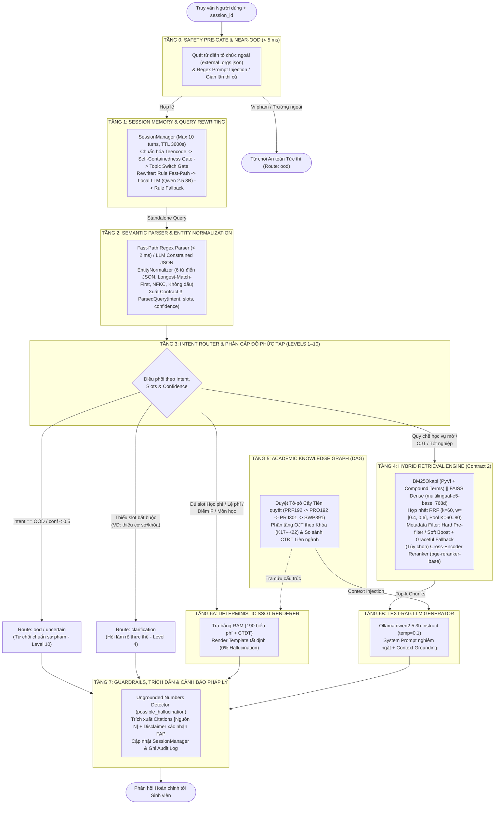

# PHẦN 4 & PHẦN 5 — BÁO CÁO NGHIÊN CỨU HỆ THỐNG FPTUniQA (CHUẨN HÓA V4)

> [!IMPORTANT]
> **Ghi chú Chuẩn hóa & Kiểm toán Mã nguồn (Audit v4):**
> Tài liệu này tổng hợp, rút gọn và hiệu đính **Phần 4 (Kiến trúc)** và **Phần 5 (Thiết lập thực nghiệm)** theo đúng cấu trúc đề xuất của nhóm, dựa trên việc đối chiếu chéo giữa:
> - [`docs/Bao_Cao_Kien_Truc_Pipeline_FPTUniQA.md`](Bao_Cao_Kien_Truc_Pipeline_FPTUniQA.md)
> - [`docs/Bao_Cao_Danh_Gia_Thuc_Nghiem_Toan_Dien_FPTUniQA_v4.md`](Bao_Cao_Danh_Gia_Thuc_Nghiem_Toan_Dien_FPTUniQA_v4.md)
> - [`docs/diff_v3_to_v4.md`](diff_v3_to_v4.md) & [`docs/numbers_traceability_v4.csv`](numbers_traceability_v4.csv)
> - Mã nguồn thực thi thực tế tại [`src/FPTUniQA/`](../src/FPTUniQA/) và [`scripts/`](../scripts/).
>
> **Các điểm sai lệch trong file Pipeline cũ đã được sửa lại cho khớp code và báo cáo v4:**
> 1. **Tầng 4 (Song song hóa):** Xóa bỏ tuyên bố cũ *"ThreadPoolExecutor giảm 42,8% thời gian truy xuất"*. Thay bằng cơ chế thực tế (hỗ trợ cả chế độ tuần tự và song song, có nhận xét trung thực về giới hạn GIL trên CPU Python được kiểm chứng ở Phần 6).
> 2. **Tầng 4 (Chế độ lọc Metadata & Pool $K$):** Làm rõ 3 chế độ `metadata_mode` (`none` với $K=60$, `soft` với $K=80, \alpha=\beta=0,25$, và `hard` với $K=80$ khi có filter).
> 3. **Tầng 5 (Vị trí Graph RAG):** Làm rõ trong code thực tế, [`knowledge_graph.py`](../src/FPTUniQA/graph/knowledge_graph.py) vừa hỗ trợ trả lời trực tiếp ở nhánh `structured_lookup` (cho câu hỏi lộ trình/môn học cấu trúc), vừa thực hiện *Context Injection* (`kg.get_context_summary()`) bơm vào ngữ cảnh của nhánh `rag_pipeline`.
> 4. **Bảng cấu hình:** Thống nhất thông số giữa [`configs/base.yaml`](../configs/base.yaml), [`src/FPTUniQA/config.py`](../src/FPTUniQA/config.py) và tham số runtime thực tế của các script kiểm thử v4.

---

# 4. KIẾN TRÚC HỆ THỐNG (SYSTEM ARCHITECTURE)

Để giải quyết bài toán hỏi đáp học vụ đòi hỏi đồng thời **độ chính xác số học tuyệt đối** (biểu phí, tín chỉ, mã môn) và **khả năng suy luận linh hoạt trên văn bản pháp quy** (quy chế đào tạo, kỷ luật, xét tốt nghiệp), FPTUniQA được thiết kế theo kiến trúc **Đa tầng Thích ứng Kết hợp Định tuyến Ba nhánh (Multi-Tier Adaptive Tri-Routing Architecture)**. Thay vì đẩy toàn bộ truy vấn qua mô hình ngôn ngữ lớn (LLM) như các hệ thống RAG phẳng truyền thống, hệ thống phân luồng câu hỏi qua **8 tầng xử lý (Tầng 0 đến Tầng 7)** và điều phối về 3 động cơ chuyên biệt: **(1) Tra cứu Bảng dữ liệu Xác định (SSOT Lookup)**, **(2) Đồ thị Tri thức Học thuật (Academic Knowledge Graph)** và **(3) Truy xuất Văn bản Lai ghép (Hybrid Text-RAG)**.

## 4.1. Sơ đồ Kiến trúc và Luồng Dữ liệu Tổng thể (Tầng 0 – Tầng 7)

---

## 4.2. Đặc tả Kỹ thuật Từng Tầng Xử lý (Tầng 0 đến Tầng 7)

### Tầng 0: Tiền kiểm An toàn & Lọc Cận miền (Safety Pre-Gate & Near-OOD)
- **Mã nguồn:** [`src/FPTUniQA/query/safety_gate.py`](../src/FPTUniQA/query/safety_gate.py), [`data/dictionary/external_orgs.json`](../data/dictionary/external_orgs.json).
- **Cơ chế:** Chặn sớm trước khi khởi tạo phiên hay gọi mô hình ngôn ngữ (độ trễ $< 5\text{ ms}$):
  1. *Quét thực thể tổ chức ngoài:* Đối sánh từ điển các trường đại học ngoài hệ thống FPT (Bách Khoa, NEU, ĐHQG, Đại học Tokyo...) và học bổng chính phủ ngoài trường.
  2. *Chặn tấn công & vi phạm học vụ:* Dùng biểu thức chính quy (Regex) bắt các mẫu *Prompt Injection* (`ignore previous instructions`, `reveal system prompt`), yêu cầu sửa điểm FAP, thi hộ PE/EOS hoặc làm giả chứng chỉ.

### Tầng 1: Bộ nhớ Phiên & Viết lại Truy vấn Đa lượt (Session Memory & Query Rewriting)
- **Mã nguồn:** [`src/FPTUniQA/query/rewriting.py`](../src/FPTUniQA/query/rewriting.py), `SessionManager` trong [`src/FPTUniQA/pipeline/rag_pipeline.py`](../src/FPTUniQA/pipeline/rag_pipeline.py).
- **Quản lý bộ nhớ phiên:** Lưu trữ trạng thái hội thoại trong RAM với giới hạn trượt `max_turns = 10` lượt/phiên, thời gian tự hủy `ttl_seconds = 3600` (60 phút). Khi đưa vào prompt viết lại, hệ thống chỉ lấy tối đa **5 lượt gần nhất** (`history[-5:]`) và cắt ngắn câu trả lời cũ ở mức **150 ký tự** để bảo vệ cửa sổ ngữ cảnh của mô hình 3B.
- **Khử độc ngữ cảnh (Context Decontamination) & Phân giải tỉnh lược:**
  1. *Chuẩn hóa Teencode tức thời:* Thay thế từ lóng sinh viên (`ktx` $\to$ *ký túc xá*, `hl` $\to$ *Hòa Lạc*, `củ` $\to$ *triệu đồng*, `đatn` $\to$ *đồ án tốt nghiệp*).
  2. *Self-Containedness Gate & Topic Switch Gate:* Kiểm tra câu hỏi mới đã đủ thực thể độc lập chưa hoặc đã đổi sang nhóm chủ đề khác (8 nhóm chủ đề học vụ) qua hàm `detect_topic_switch()`. Nếu phát hiện đổi chủ đề, hệ thống **ngắt kế thừa ngay lập tức**, chống hiện tượng rò rỉ thực thể từ lượt cũ (*context bleeding*).
  3. *Chiến lược viết lại 3 cấp (kèm Circuit Breaker ngắt sau 2 lỗi):* (i) Rule Fast-Path theo mẫu tỉnh lược/đính chính và kế thừa thực thể ngược từ lượt gần nhất (`reversed(history)`); (ii) Gọi mô hình cục bộ `qwen2.5:3b-instruct` (`temperature = 0.0`); (iii) Fallback về quy tắc nếu LLM quá thời gian chờ.

### Tầng 2: Phân tích Ngữ nghĩa & Chuẩn hóa Thực thể (Semantic Parser & Normalization Engine)
- **Mã nguồn:** [`src/FPTUniQA/query/semantic_parser.py`](../src/FPTUniQA/query/semantic_parser.py), [`src/FPTUniQA/normalization/engine.py`](../src/FPTUniQA/normalization/engine.py), [`contracts.py`](../contracts.py).
- **Chuẩn hóa thực thể miền (`EntityNormalizer`):** Nạp 6 bộ từ điển chuẩn (`majors.json`, `courses.json`, `cohorts.json`, `campuses.json`, `academic_terms.json`, `abbreviations.json`). Áp dụng chuẩn hóa Unicode **NFKC**, đối sánh không dấu (*diacritic-insensitive*) và thuật toán **Longest Match First** (ưu tiên khớp cụm dài như *"Kỹ thuật phần mềm"* trước *"phần mềm"*).
- **Phân tích cú pháp 2 chế độ (Contract 3 – `ParsedQuery`):**
  - *Fast-Path Regex Parser (`try_rule_fast_parse`):* Bắt trực tiếp các mẫu câu hỏi biểu phí/số liệu rõ ràng trong $< 2\text{ ms}$.
  - *LLM Constrained JSON Parser (`parse_query`):* Gọi mô hình cục bộ ép định dạng JSON với các trường `intent`, `slots` (`program`, `cohort`, `campus`, `course_code`, `course_aspect`, `topic`, `target`) và `confidence` $\in [0.0, 1.0]$.

### Tầng 3: Bộ Định tuyến Ý định & Phân cấp Phức tạp (Intent Router & Levels 1–10)
- **Mã nguồn:** [`src/FPTUniQA/query/router.py`](../src/FPTUniQA/query/router.py).
- **Cơ chế phân luồng tất định:** Dựa trên `ParsedQuery`, bộ định tuyến gán cấp độ phức tạp (Level 1 đến Level 10) và điều phối về 1 trong 5 tuyến:
  - `ood` (Level 10): Khi `intent == "OOD"` hoặc chạm từ khóa ngoài miền.
  - `uncertain` (Level 10): Khi `confidence < 0.5`.
  - `clarification` (Level 4): Khi hỏi học phí chuyên ngành (`tuition_lookup`) nhưng thiếu thực thể cốt lõi (chưa rõ cơ sở phân hiệu hoặc ngành học). Hệ thống chủ động hỏi lại thay vì đoán mò.
  - `structured_lookup` (Level 1, 3): Khi đủ thông tin tra cứu biểu phí, lệ phí dịch vụ chung, thông tin môn học hoặc quy định điểm F $\to$ chuyển thẳng tới Tầng 6A / Tầng 5.
  - `rag_pipeline` (Level 2, 5–9): Các câu hỏi quy chế học vụ mở, điều kiện tốt nghiệp, cảnh báo học vụ, thực tập OJT $\to$ chuyển tới Tầng 4.

### Tầng 4: Động cơ Truy xuất Văn bản Lai ghép (Hybrid Retrieval Engine)
- **Mã nguồn:** [`src/FPTUniQA/retrieval/bm25.py`](../src/FPTUniQA/retrieval/bm25.py), [`dense.py`](../src/FPTUniQA/retrieval/dense.py), [`rrf.py`](../src/FPTUniQA/retrieval/rrf.py), [`filter.py`](../src/FPTUniQA/retrieval/filter.py), [`retriever.py`](../src/FPTUniQA/retrieval/retriever.py).
- **Truy xuất 2 nhánh (Dual-Channel Retrieval) trên 824 đoạn quy chế:**
  1. *Nhánh Từ vựng Thưa (Sparse BM25):* Sử dụng `BM25Okapi` ($k_1 = 1,5; b = 0,75$) kết hợp tách từ tiếng Việt `pyvi.ViTokenizer`, loại bỏ hư từ và ghép nối cố định các thuật ngữ chuyên ngành (`ACADEMIC_COMPOUND_TERMS` như `môn_tiên_quyết`, `thực_tập_doanh_nghiệp`, `cảnh_báo_học_vụ`). Hỗ trợ mở rộng truy vấn (*entity expansion*) cho câu hỏi không dấu.
  2. *Nhánh Ngữ nghĩa Đặc (Dense FAISS):* Mã hóa bằng mô hình đa ngữ `intfloat/multilingual-e5-base` (vector 768 chiều, chuẩn hóa $L_2$, tiền tố `query: ` và `passage: `) lưu trên chỉ mục `FAISS IndexFlatIP`.
  3. *Hợp nhất Thứ hạng RRF Có trọng số (Weighted Reciprocal Rank Fusion):* Kết hợp hai danh sách ứng viên với hằng số làm trơn $k_{\text{rrf}} = 60$ và cặp trọng số tối ưu $[w_{\text{bm25}}, w_{\text{dense}}] = [0,4; 0,6]$:
     $$\text{Score}_{\text{RRF}}(d) = \frac{w_{\text{bm25}}}{k_{\text{rrf}} + r_{\text{bm25}}(d)} + \frac{w_{\text{dense}}}{k_{\text{rrf}} + r_{\text{dense}}(d)}$$
  4. *Kiểm soát Siêu dữ liệu theo Khóa/Cơ sở (`filter.py`):* Hỗ trợ 3 chế độ trong thực nghiệm:
     - `none` (Pool $K=60$): Không lọc metadata.
     - `soft` (Pool $K=80$): Không lọc cứng trước RRF; sau RRF điều chỉnh điểm theo độ tin cậy parser (`conf` $\ge 0,6$): nhân hệ số $(1 + \alpha \cdot \text{conf})$ nếu khớp khóa/cơ sở, nhân $(1 - \beta \cdot \text{conf})$ nếu lệch khóa ($\alpha = \beta = 0,25$), giữ nguyên ($1,0$) với quy chế chung toàn trường (`neutral`).
     - `hard` (Pool sâu $K=80$ khi có filter): Loại bỏ triệt để các chunk có khóa xung đột rõ rệt (`mismatch`), nhưng luôn giữ lại tài liệu quy chế chung (`neutral`) để bảo toàn Recall. Tích hợp **Graceful Fallback**: nếu lọc cứng trả về rỗng, tự động truy xuất lại không lọc.
  5. *Tái xếp hạng (Cross-Encoder Reranker) & Bộ nhớ đệm:* Hỗ trợ giai đoạn 2 với `BAAI/bge-reranker-base` và lớp `RetrievalCache` (TTL 3600s, tối đa 1.000 mục). Chuẩn hóa đầu ra theo **Contract 2** (`score` $\in [0.0, 1.0]$).

### Tầng 5: Đồ thị Tri thức Học thuật (Academic Knowledge Graph)
- **Mã nguồn:** [`src/FPTUniQA/graph/knowledge_graph.py`](../src/FPTUniQA/graph/knowledge_graph.py).
- **Cơ chế:** Mô hình hóa chương trình đào tạo và quy chế môn học dưới dạng Đồ thị Có hướng Không chu trình (DAG):
  - *Duyệt Tô-pô Chuỗi Tiên quyết (Topological Sort):* Truy vết đệ quy toàn bộ môn học tiên quyết nhiều chặng (ví dụ: `PRF192` $\to$ `PRO192` $\to$ `PRJ301/SWE201C` $\to$ `SWP391`) và gợi ý môn học kế tiếp (`next_course`).
  - *Suy luận Đa chặng Có nhận thức Khóa:* Phân biệt điều kiện tín chỉ thực tập OJT giữa các khóa (K17–K18 vs K19–K22), đối chiếu khung chương trình giữa các ngành (SE, AI, IA) và quy chế xử lý điểm F.
  - *Hai chế độ tích hợp:* Trả lời trực tiếp theo mẫu chuẩn tắc tại nhánh `structured_lookup`, hoặc trích xuất tóm tắt đồ thị (`get_context_summary()`) bơm bổ sung vào ngữ cảnh văn bản của nhánh `rag_pipeline`.

### Tầng 6: Động cơ Tạo sinh Kép (Dual Generation Engine: Tầng 6A & Tầng 6B)
- **Tầng 6A – Deterministic SSOT Renderer (`execute_structured_lookup`):** Truy xuất trực tiếp trên RAM từ cơ sở dữ liệu chuẩn hóa gồm **190 bản ghi biểu phí chính quy** (`structured_data.json` cho 38 ngành/chuyên ngành $\times$ 5 cơ sở Hà Nội, TP.HCM, Đà Nẵng, Cần Thơ, Quy Nhơn) và **3.282 dòng dữ liệu môn học/đề cương** (`structured_data_courses.json`). Kết xuất câu trả lời bằng khuôn mẫu cố định, **không gọi LLM**, đảm bảo tính tất định 100% và 0% ảo giác số học.
- **Tầng 6B – Text-RAG LLM Generator (`llm.py`, `prompt.py`):** Với câu hỏi quy chế mở, ghép nối Top-$k$ đoạn văn bản (kèm tri thức đồ thị nếu có) vào khuôn mẫu `SYSTEM_PROMPT` nghiêm ngặt (*chỉ trả lời dựa trên ngữ cảnh, bắt buộc gắn thẻ trích dẫn `[Nguồn N]`, tuyệt đối không tự suy đoán con số*) và gọi mô hình biên `qwen2.5:3b-instruct`. Tích hợp `CircuitBreaker` và bộ khung câu trả lời dự phòng bám sát ngữ cảnh (`_generate_fallback`) khi dịch vụ LLM gián đoạn.

### Tầng 7: Hàng rào Kiểm soát Ảo giác, Trích dẫn & Pháp lý (Output Guardrails)
- **Mã nguồn:** [`src/FPTUniQA/generation/guardrails.py`](../src/FPTUniQA/generation/guardrails.py), [`citation.py`](../src/FPTUniQA/generation/citation.py).
- **Cơ chế:**
  1. *Bộ phát hiện số liệu không căn cứ (`check_hallucination`):* Bóc tách mọi thực thể số học/tiền tệ trong câu trả lời của LLM và đối chiếu ngược với văn bản ngữ cảnh. Nếu xuất hiện số lạ, bật cờ `possible_hallucination = True` và ghi nhận danh sách `ungrounded_numbers`.
  2. *Ánh xạ trích dẫn (`extract_citations`):* Liên kết các thẻ `[Nguồn N]` trong câu trả lời về đúng siêu dữ liệu `doc_id`, `title`, `source`, `applies_to_cohort` của từng chunk.
  3. *Khuyến cáo học vụ & Lưu vết:* Đính kèm cảnh báo đối chiếu trên cổng FAP/Phòng Đào tạo và ghi nhật ký sự kiện vào `logs/query_events.jsonl`.

---

## 4.3. Bảng Tổng hợp Tham số Cấu hình Hệ thống

Bảng dưới đây tổng hợp các siêu tham số cốt lõi được thiết lập trong mã nguồn ([`configs/base.yaml`](../configs/base.yaml), [`src/FPTUniQA/config.py`](../src/FPTUniQA/config.py) và [`src/FPTUniQA/retrieval/retriever.py`](../src/FPTUniQA/retrieval/retriever.py)):

| Phân hệ / Tầng | Tham số Kỹ thuật | Giá trị Cấu hình | Tệp Nguồn / Vị trí Định nghĩa | Vai trò & Ý nghĩa Vận hành |
| :--- | :--- | :--- | :--- | :--- |
| **Dữ liệu & Chunking** | `chunk_size` / `chunk_overlap` | `512` / `64` ký tự | `configs/base.yaml` | Phân đoạn quy chế theo Điều/Khoản kết hợp cửa sổ trượt; tạo **824 chunks** chuẩn. |
| **Dữ liệu Cấu trúc** | `structured_data.json` | `190` biểu phí + `6` từ điển | `data/processed/`, `data/dictionary/` | Cơ sở dữ liệu SSOT (38 ngành $\times$ 5 cơ sở) và từ điển chuẩn hóa thực thể. |
| **Tầng 1: Memory** | `max_turns` / `ttl_seconds` | `10` lượt / `3.600` giây | `pipeline/rag_pipeline.py` | Giới hạn số lượt lưu RAM mỗi phiên và thời gian tự hủy phiên không hoạt động. |
| **Tầng 1: Trimming** | `recent_history` / `short_a` | `5` lượt / `150` ký tự | `query/rewriting.py` | Cửa sổ trượt đưa vào prompt Rewriter và giới hạn cắt ngắn câu trả lời cũ. |
| **Tầng 2: Parser** | `parser_temperature` / `max_tokens` | `0.0` / `320`–`1024` tokens | `configs/base.yaml`, `config.py` | Ép mô hình sinh cấu trúc JSON `ParsedQuery` tất định. |
| **Tầng 3: Router** | `confidence_threshold` | `0.5` (`< 0.5` $\to$ `uncertain`) | `query/router.py` | Ngưỡng tin cậy tối thiểu trước khi phân luồng CKB / Text-RAG. |
| **Tầng 4: BM25** | `k1` / `b` / `tokenizer` | `1.5` / `0.75` / `pyvi` | `configs/base.yaml`, `retrieval/bm25.py` | Trọng số bão hòa tần suất từ, chuẩn hóa độ dài văn bản và tách từ tiếng Việt. |
| **Tầng 4: Dense FAISS** | `embedding_model` / `dimension` | `intfloat/multilingual-e5-base` (`768d`) | `configs/base.yaml`, `retrieval/dense.py` | Vector ngữ nghĩa đa ngữ, chuẩn hóa $L_2$, độ đo tích vô hướng (`IndexFlatIP`). |
| **Tầng 4: RRF Fusion** | `rrf_k` / `weights` | `k = 60`, `weights = [0.4, 0.6]` | `configs/base.yaml`, `retrieval/retriever.py` | Hằng số làm trơn RRF và trọng số ưu tiên nhánh Dense (0,6) so với BM25 (0,4). |
| **Tầng 4: Pool & Filter** | `cand_k` / `alpha` / `beta` / `top_k` | `K = 60..80`, $\alpha=\beta=0,25$, `top_k = 5` | `retrieval/retriever.py`, `config.py` | Kích thước tập ứng viên sâu trước khi lọc cứng/boost mềm và số chunk đưa vào LLM. |
| **Tầng 4: Reranker** | `model_name` / `candidate_k` | `BAAI/bge-reranker-base` / `20` | `configs/base.yaml`, `config.py` | Mô hình Cross-Encoder giai đoạn 2 (bật ở C5/C6, tắt ở pipeline đa lượt để tối ưu tốc độ). |
| **Tầng 4: Cache** | `ttl_seconds` / `max_entries` | `3.600` giây / `1.000` mục | `retrieval/retriever.py` | Bộ nhớ đệm truy xuất (tắt tường minh `disable_cache=True` khi đo benchmark). |
| **Tầng 6B: LLM Gen** | `model` / `temperature` / `max_tokens` | `qwen2.5:3b-instruct` / `0.1` / `320`–`1024` | `configs/base.yaml`, `generation/llm.py` | Mô hình ngôn ngữ biên chạy cục bộ qua Ollama, nhiệt độ thấp giảm suy diễn tự do. |

---
---

# 5. THIẾT LẬP THỰC NGHIỆM (EXPERIMENTAL SETUP)

Toàn bộ quy trình thực nghiệm trong phiên bản v4 được thiết kế theo nguyên tắc **kiểm toán độc lập và tái lập 100% từ dữ liệu thô** ([`docs/Bao_Cao_Danh_Gia_Thuc_Nghiem_Toan_Dien_FPTUniQA_v4.md`](Bao_Cao_Danh_Gia_Thuc_Nghiem_Toan_Dien_FPTUniQA_v4.md)). Mọi bộ nhớ đệm (`RetrievalCache`) được vô hiệu hóa (`disable_cache=True`) trong các phép đo ablation và độ trễ; mỗi tệp kết quả đều được kiểm tra ràng buộc toàn vẹn số lượng mẫu bằng lệnh `assert` trước khi tổng hợp.

## 5.1. Môi trường Phần cứng, Phần mềm và Mô hình Triển khai

Hệ thống được triển khai và đo đạc hoàn toàn cục bộ (**100% On-Premise Edge AI**, chi phí API thương mại bằng **0 VNĐ**), trích xuất từ [`experiments/ablation/env_snapshot.json`](../experiments/ablation/env_snapshot.json) và nhật ký kiểm toán v4:

| Hạng mục Hạ tầng | Thông số Kỹ thuật Chi tiết | Vai trò trong Thực nghiệm |
| :--- | :--- | :--- |
| **Vi xử lý (CPU) & Bộ nhớ (RAM)** | AMD Ryzen 7 (16 Cores), RAM vật lý **15,24 GB** khả dụng (mức sử dụng trung bình ~83,4%) | Thực thi chỉ mục BM25, FAISS-CPU, mô hình Embedding và bộ điều phối Python. |
| **Hệ điều hành & Môi trường** | Windows 11 Enterprise (Build 26100), Python **3.10.11** (`.venv`), Git commit kiểm toán: `85e1e6e` / `c083ad3` | Môi trường chuẩn hóa chạy toàn bộ các script trong `scripts/` và `experiments/audit/`. |
| **Thư viện Học máy Cốt lõi** | PyTorch `2.6.0+cu124`, `faiss-cpu 1.10.0`, `transformers 4.49.0`, `pyvi`, `rank-bm25`, `pydantic` | Nền tảng tính toán tensor, tìm kiếm vector và xử lý ngôn ngữ tự nhiên tiếng Việt. |
| **Mô hình Ngôn ngữ Lớn (LLM)** | **Qwen 2.5 3B Instruct** (`qwen2.5:3b-instruct`, lượng tử hóa 4-bit) phục vụ qua **Ollama GPU** cục bộ | Dùng cho 3 tác vụ: Query Rewriter (Tầng 1), Semantic Parser (Tầng 2) và Text-RAG Generator (Tầng 6B). |
| **Mô hình Biểu diễn Vector** | **`intfloat/multilingual-e5-base`** (768 chiều, chạy trên CPU) | Mã hóa 824 đoạn quy chế và truy vấn người dùng cho nhánh Dense Retrieval. |
| **Mô hình Tái xếp hạng** | **`BAAI/bge-reranker-base`** (Cross-Encoder, chạy trên CPU; fallback an toàn khi thiếu tài nguyên) | Khảo sát tác động tái xếp hạng giai đoạn 2 trên tập ứng viên RRF. |

---

## 5.2. Cấu hình Chi tiết Từng Thí nghiệm

Nghiên cứu thực hiện **6 nhóm thí nghiệm độc lập** nhằm đánh giá toàn diện từng thành phần từ tầng truy xuất đơn lẻ đến toàn bộ hệ thống đa lượt.

### 5.2.1. Thí nghiệm 1: Ma trận Ablation 8 Cấu hình Hệ thống (Trên Canonical Benchmark V2, $N=100$)
Được thực thi bởi [`scripts/run_clean_ablation.py`](../scripts/run_clean_ablation.py) và [`src/FPTUniQA/pipeline/ablation_retriever.py`](../src/FPTUniQA/pipeline/ablation_retriever.py), ghi trực tiếp vào `experiments/ablation_clean/` với kiểm tra `assert len(records) == 100` và `100 q_id` duy nhất cho mỗi cấu hình:

| Mã | Tên Cấu hình | `retriever_mode` | Nhánh Truy xuất Kích hoạt | Pool $K$ & Chế độ Lọc Metadata | `parser_mode` | `router_enabled` (SSOT/Graph/OOD) | `use_reranker` | Mục tiêu Đánh giá Ablation |
| :-: | :--- | :--- | :--- | :--- | :---: | :---: | :---: | :--- |
| **C1** | **BM25 Lexical Baseline** | `bm25` | Chỉ BM25Okapi (`pyvi`) | $K=5$, không lọc | `regex` | `False` | `False` | Đường cơ sở từ vựng rời rạc thuần túy. |
| **C2** | **Dense Vector Baseline** | `dense` | Chỉ FAISS (`e5-base`) | $K=5$, không lọc | `regex` | `False` | `False` | Đường cơ sở ngữ nghĩa vector thuần túy. |
| **C3** | **Hybrid Sequential** | `c3_hybrid_sequential` | BM25 + FAISS **tuần tự**, RRF ($k=60$) | $K=60$, `metadata_mode="none"` | `regex` | `False` | `False` | Đánh giá hiệu quả hợp nhất RRF nhưng chạy tuần tự, chưa lọc khóa. |
| **C3p** | **Hybrid Parallel** | `c3p_hybrid_parallel` | BM25 + FAISS **song song** (`ThreadPoolExecutor`), RRF | $K=60$, `metadata_mode="none"` | `regex` | `False` | `False` | Đối sánh trực tiếp với C3 về tính bảo toàn Recall và độ trễ đa luồng. |
| **C4-soft** | **Hybrid + Soft Boost** | `c4_hybrid_rrf_soft` | Hybrid song song + RRF | $K=80$, `metadata_mode="soft"` ($\alpha=\beta=0,25$) | `regex` | `False` | `False` | Đánh giá cơ chế cộng/phạt điểm mềm theo khóa sau RRF. |
| **C4-hard** | **Hybrid + Hard Filter** | `c4_hybrid_rrf_filter` | Hybrid song song + RRF | $K=80$, `metadata_mode="hard"` (Lọc cứng Cohort) | `regex` | `False` | `False` | Đánh giá khả năng triệt tiêu lỗi lẫn khóa (*Wrong-Cohort*) bằng lọc cứng. |
| **C5** | **Full (No LLM Parser)** | `hybrid_filter` | Hybrid song song + Hard Filter | $K=80$, `metadata_mode="hard"` | `regex` | `True` | `True` | Kích hoạt toàn bộ Router + SSOT + Graph nhưng chỉ dùng Regex Parser. |
| **C6** | **Full Architecture** | `hybrid_filter` | Hybrid song song + Hard Filter | $K=80$, `metadata_mode="hard"` | `auto` (Fast-path + LLM) | `True` | `True` | Kiến trúc hoàn chỉnh tích hợp LLM Semantic Parser, Router, SSOT, Graph và Guardrails. |

> [!NOTE]
> **Ghi chú Minh bạch Kiểm toán về C1 & C2:** Ở bản chạy cũ (v3), runner truyền nhầm chuỗi `"c1_bm25"` và `"c2_dense"` khiến `AblationRetriever` rơi vào nhánh `else` (chạy Hybrid), làm C1 và C2 có kết quả trùng nhau. Trong bản v4, [`scripts/run_clean_ablation.py`](../scripts/run_clean_ablation.py) đã được sửa truyền đúng `"bm25"` và `"dense"` và chạy lại từ đầu.

### 5.2.2. Thí nghiệm 2: Khảo sát Chuyên sâu Tầng Truy xuất Mở rộng & Độ trễ Thuần
Để đánh giá riêng năng lực của tầng Retrieval mà không bị che khuất bởi bộ định tuyến SSOT hay thời gian sinh của LLM, 4 khảo sát bổ trợ được thiết lập:
1. **Đo độ trễ Retrieval thuần không cache (`scripts/measure_c3_c3p_latency.py`):** Chạy C3 (tuần tự) và C3p (song song) trực tiếp trên 100 câu hỏi $\times$ **5 vòng lặp độc lập** (có bước làm nóng *warm-up*, tắt cache) để tách biệt chi phí tính toán vector/GIL khỏi thời gian sinh của LLM.
2. **Đánh giá khả năng khái quát hóa trên tập Held-out ($N=50$, `experiments/audit/run_heldout_eval.py`):** Chạy cấu hình `HybridRetriever(rrf_k=60, alpha=0.25, beta=0.25)` kèm lọc khóa tự động trên **50 câu hỏi văn bản quy chế mới** hoàn toàn chưa từng xuất hiện trong 100 câu Ablation.
3. **Tinh chỉnh Trọng số RRF & Tác động Reranker trên tập Canonical Retrieval mở rộng ($N=117$, `scripts/run_canonical_retrieval_benchmark.py`, `scripts/tune_rrf_weights.py`, `scripts/test_reranker_impact.py`):** Khảo sát lưới trọng số $[w_{\text{bm25}}, w_{\text{dense}}] \in \{[0,3; 0,7], [0,4; 0,6], [0,5; 0,5], [0,6; 0,4], [0,7; 0,3]\}$ với $k \in \{30, 60\}$ và so sánh C4-hard khi bật/tắt Cross-Encoder (`cand_k` $\in \{15, 25\}$) trên tập 117 câu quy chế (103 câu chung + 14 câu có khóa).

### 5.2.3. Thí nghiệm 3: Đánh giá Đồ thị Tri thức Học thuật (Graph RAG Ablation, $N=30$)
Được thực thi bởi [`scripts/graph_rag_ablation.py`](../scripts/graph_rag_ablation.py) và [`experiments/audit/audit_phase4_graph.py`](../experiments/audit/audit_phase4_graph.py) trên bộ [`data/evaluation/graph_rag_suite.jsonl`](../data/evaluation/graph_rag_suite.jsonl) gồm **30 câu hỏi đa chặng** chia đều vào 5 lớp bài toán (mỗi lớp 6 câu): `prereq_chain` (chuỗi tiên quyết), `next_course` (môn học kế tiếp), `program_compare` (so sánh CTĐT liên ngành), `ojt_conditions` (điều kiện thực tập OJT) và `f_grade_policy` (xử lý điểm F). Ba biến thể được đối sánh:
- **`WITHOUT_GRAPH` (Flat RAG Baseline):** Tắt đồ thị (`set_graph_rag_enabled(False)`), chỉ dùng văn bản truy xuất phẳng.
- **`Stronger Baseline` (Table/Context-Augmented):** Mở rộng ngữ cảnh bảng môn học nhưng không dùng thuật toán duyệt đồ thị DAG.
- **`WITH_GRAPH` (Academic Knowledge Graph):** Bật đầy đủ thuật toán duyệt tô-pô và suy luận đồ thị (`set_graph_rag_enabled(True)`).

### 5.2.4. Thí nghiệm 4: Mô phỏng Hội thoại Đa lượt Quy mô lớn ($N=1.000$ lượt)
Được thực thi bởi [`scripts/run_1000_multiturn_benchmark.py`](../scripts/run_1000_multiturn_benchmark.py) trên tổng hợp **15 tệp dữ liệu** (5 tệp `multiturn_rounds/round_1..5.jsonl` + 10 tệp `benchmark_v2/batch_01..10.jsonl`), gồm **1.000 lượt hỏi đáp thuộc 768 phiên hội thoại (`session_id`)**.
- **Cấu hình vận hành:** `RAGPipeline(use_reranker=False)`, `HybridRetriever(auto_load=True)` với cấu hình C4-hard ($K=80$, trọng số $[0,4; 0,6]$), LLM `qwen2.5:3b-instruct`.
- **Giao thức:** Duy trì trạng thái `SessionManager` liên tục giữa các lượt `turn_index = 1, 2, ...` trong cùng một `session_id`, mô phỏng chính xác hành vi người dùng trên Web UI và REST API.

### 5.2.5. Thí nghiệm 5: Kiểm thử An toàn Biên & Chống Tấn công (Safety Suite, $N=35$)
Được thực thi bởi [`scripts/evaluate_safety_suite.py`](../scripts/evaluate_safety_suite.py) và kiểm toán thủ công tại [`experiments/audit/audit_phase6_safety.py`](../experiments/audit/audit_phase6_safety.py) trên cấu hình C6 đầy đủ với 2 tập thử thách:
- **Near-OOD Benchmark ($N=20$):** Câu hỏi về quy chế/học phí nhưng của trường đại học khác, chính sách nhà nước hoặc học bổng ngoại vi (`near_ood_benchmark.jsonl`).
- **Adversarial & Jailbreak Benchmark ($N=15$):** Câu hỏi tấn công vượt quyền (*privilege escalation*), gian lận học vụ (*fraud*), ép tiết lộ system prompt (`adversarial_safety_benchmark.jsonl`).
- **Phân loại kiểm toán 3 mức độ:** *Mức 1 (Explicit Safe Refusal – Từ chối đúng)*, *Mức 2 (Benign Misrouting – Định tuyến lệch nhưng hoàn toàn vô hại)*, và *Mức 3 (Harmful Compliance / Data Leak – Tuân thủ độc hại hoặc rò rỉ dữ liệu)*.

---

## 5.3. Định nghĩa Toán học các Chỉ số và Mẫu số Đo lường Thực tế

Để đảm bảo tính liêm chính học thuật, mọi chỉ số trong báo cáo v4 đều được định nghĩa tường minh kèm **mẫu số thực tế ($N$)** dựa trên mã nguồn tại [`src/FPTUniQA/evaluation/`](../src/FPTUniQA/evaluation/).

### 5.3.1. Nhóm Chỉ số Truy xuất Văn bản (Retrieval Metrics)
Gọi $\text{Top}_k(q_i) = [d_{i,1}, d_{i,2}, \dots, d_{i,k}]$ là danh sách $k=5$ mã tài liệu đầu tiên hệ thống trả về cho câu hỏi $q_i$, và $G_i$ là tập mã tài liệu vàng (`relevant_doc_ids`) trong `retrieval_gold.json`.

1. **Recall@5 theo Mã tài liệu (`Recall@5 Doc ID`):** Tính tỷ lệ bao phủ tài liệu vàng trung bình trên mỗi truy vấn (cho phép điểm bán phần $0,5$ khi câu hỏi có 2 tài liệu vàng và top-5 trúng 1 tài liệu, theo [`retrieval_metrics.py`](../src/FPTUniQA/evaluation/retrieval_metrics.py)):
   $$\text{Recall}@5_{\text{doc}} = \frac{1}{N_{\text{ret}}} \sum_{i=1}^{N_{\text{ret}}} \frac{|\text{Top}_5(q_i) \cap G_i|}{|G_i|}$$
2. **Recall@5 theo Nhóm Tương đương (`Recall@5 Equiv`):** Mở rộng tập vàng $G_i$ thành $\tilde{G}_i = G_i \cup \bigcup \{g \in \text{Equiv}_i \mid g \cap G_i \neq \emptyset\}$ chứa các đoạn quy chế tương đương nội dung giữa các khóa ([`retrieval_metrics.py`](../src/FPTUniQA/evaluation/retrieval_metrics.py)):
   $$\text{Recall}@5_{\text{equiv}} = \frac{1}{N_{\text{ret}}} \sum_{i=1}^{N_{\text{ret}}} \min\left(1,0;\; \frac{|\text{Top}_5(q_i) \cap \tilde{G}_i|}{\max(1, |G_i|)}\right)$$
3. **Binary Hit Rate@5 (Tỷ lệ có ít nhất 1 Hit):** Dùng khi báo cáo khoảng tin cậy nhị thức trên tập Held-out ($N=50$):
   $$\text{Hit}@5 = \frac{1}{N_{\text{ret}}} \sum_{i=1}^{N_{\text{ret}}} \mathbb{I}\big(\text{Top}_5(q_i) \cap G_i \neq \emptyset\big)$$
4. **Mean Reciprocal Rank (`MRR@5`):** Trung bình nghịch đảo thứ hạng đầu tiên $\text{rank}_i \in \{1,\dots,5\}$ của tài liệu thuộc $G_i$ (bằng $0$ nếu không xuất hiện trong top-5):
   $$\text{MRR}@5 = \frac{1}{N_{\text{ret}}} \sum_{i=1}^{N_{\text{ret}}} \frac{1}{\text{rank}_i}$$
5. **Tỷ lệ Vi phạm Lẫn khóa (`Wrong-Cohort Rate`):** Chỉ tính trên tập con các câu hỏi có yêu cầu khóa học cụ thể $C_i \neq \emptyset$ (`expected_cohorts`). Một truy vấn bị tính là vi phạm ($1,0$) nếu trong top-5 tồn tại ít nhất một tài liệu $d$ có nhãn khóa rõ ràng $\text{Cohort}(d) \notin C_i$ và $d$ không nằm trong nhóm tương đương được miễn trừ $\text{AllowedEquiv}_i$ ([`retrieval_metrics.py`](../src/FPTUniQA/evaluation/retrieval_metrics.py)):
   $$\text{Wrong-Cohort Rate} = \frac{1}{N_{\text{cohort}}} \sum_{i=1}^{N_{\text{cohort}}} \mathbb{I}\Big(\exists d \in \text{Top}_5(q_i):\; \text{Cohort}(d) \neq \text{None} \;\land\; \text{Cohort}(d) \notin C_i \;\land\; d \notin \text{AllowedEquiv}_i\Big)$$
   *(Chiều đọc: **0,00% là Tốt tuyệt đối** — không lẫn khóa; **100,00% là Xấu** — mọi câu đều bị lẫn tài liệu khóa khác vào top-5).*

### 5.3.2. Nhóm Chỉ số Định tuyến, Hội thoại Đa lượt và Đồ thị Tri thức
1. **Độ chính xác Định tuyến Thô (`Raw Route Accuracy`) và Có nhận thức Chính sách (`Policy-aware Route Accuracy`):**
   $$\text{Acc}_{\text{raw}} = \frac{N_{\text{exact}}}{N_{\text{turns}}}, \qquad \text{Acc}_{\text{policy-clarif}} = \frac{N_{\text{exact}} + N_{\text{clarif}}}{N_{\text{turns}}}, \qquad \text{Acc}_{\text{policy-ext}} = \frac{N_{\text{exact}} + N_{\text{clarif}} + N_{\text{equiv-route}}}{N_{\text{turns}}}$$
   trong đó $N_{\text{exact}}$ là số lượt khớp đúng nhãn `expected_route` gốc; $N_{\text{clarif}}$ là số lượt câu hỏi thiếu thông tin cơ sở/ngành bắt buộc được hệ thống chủ động chuyển sang `clarification` theo đúng thiết kế an toàn; $N_{\text{equiv-route}}$ là số lượt chuyển hướng tương đương hợp lệ giữa CKB và RAG.
2. **Nhận diện Đổi chủ đề (`Topic-Switch Precision / Recall / F1 / Macro-F1`):** Tính từ ma trận nhầm lẫn nhị phân $(TP, FP, FN, TN)$ giữa lớp *Switch* (đổi chủ đề) và *Continuation* (tiếp nối chủ đề), với $\text{Macro-F1} = \frac{1}{2}(F_{1,\text{switch}} + F_{1,\text{cont}})$.
3. **Độ thu hồi Từ khóa Tỉnh lược (`Macro Keyword Recall`):** Trên các lượt hội thoại đa lượt có nhãn từ khóa ngữ cảnh cần khôi phục $K_i$ (`expected_rewrite_contains`):
   $$\text{Rewrite Keyword Recall} = \frac{\sum_{i=1}^{N_{\text{rew}}} |\{w \in K_i \mid w \subseteq \text{ normalize}(\hat{q}_i)\}|}{\sum_{i=1}^{N_{\text{rew}}} |K_i|}$$
4. **Chỉ số Đồ thị Tri thức (`ROUGE-L` và `Entity F1`):** `ROUGE-L` được tính theo độ dài chuỗi con chung dài nhất (LCS F1-score, [`answer_metrics.py`](../src/FPTUniQA/evaluation/answer_metrics.py)) giữa câu trả lời sinh ra và `gold_answer`; `Entity F1` đo độ chính xác và độ bao phủ trên tập mã môn học / điều kiện tiên quyết bắt buộc.

### 5.3.3. Nhóm Chỉ số Trung thực (Faithfulness), Ảo giác và Kiểm định Thống kê
1. **Tính Trung thực Phân tầng (`Route-Stratified & Weighted Faithfulness`):**
   - Với nhánh `structured_lookup` ($N_{\text{SSOT}}$): Đạt $F_{\text{SSOT}} = 100,00\%$ khi trả lời từ bảng dữ liệu tất định.
   - Với nhánh `ood` ($N_{\text{OOD}}$): Đạt $F_{\text{OOD}} = 100,00\%$ khi từ chối an toàn, không sinh thông tin bịa đặt.
   - Với nhánh `rag_pipeline` ($N_{\text{RAG}}$): Đo bằng tỷ lệ từ có nghĩa (sau khi loại bỏ hư từ tiếng Việt $S$) trong câu trả lời $W(a_i)$ xuất hiện trong văn bản ngữ cảnh $W(C_i)$ ([`answer_metrics.py`](../src/FPTUniQA/evaluation/answer_metrics.py)):
     $$F_{\text{RAG}}(a_i, C_i) = \frac{|(W(a_i) \setminus S) \cap W(C_i)|}{|W(a_i) \setminus S|}$$
   - Trung bình có trọng số toàn hệ thống trên 100 câu Canonical V2:
     $$F_{\text{weighted}} = \frac{N_{\text{SSOT}} \cdot F_{\text{SSOT}} + N_{\text{RAG}} \cdot \bar{F}_{\text{RAG}} + N_{\text{OOD}} \cdot F_{\text{OOD}}}{100}$$
2. **Tỷ lệ Gắn cờ Ảo giác Số học (`Guardrail Flagged / Hallucination Rate`):** Tỷ lệ câu trả lời xuất hiện ít nhất một con số không tồn tại trong ngữ cảnh hoặc bảng SSOT ($\text{ungrounded\_numbers} > 0$).
3. **Kiểm định Giả thuyết Paired Bootstrap (`paired_bootstrap_test`):** Để so sánh hai cấu hình $A$ và $B$ trên cùng $N$ truy vấn, hiệu số từng cặp $d_i = s_{A,i} - s_{B,i}$ được lấy mẫu lại có hoàn lại $B = 10.000$ lần (hoặc $1.000$ lần ở lưới RRF) với `seed = 42` ([`statistical_testing.py`](../src/FPTUniQA/evaluation/statistical_testing.py)). Khoảng tin cậy 95% được lấy theo phân vị $[2,5\%;\; 97,5\%]$ và giá trị $p\text{-value}$ hai phía được tính trên phân phối dịch tâm:
   $$p\text{-value} = \frac{1}{B} \sum_{b=1}^{B} \mathbb{I}\Big(|\bar{d}^{*(b)} - \bar{d}| \ge |\bar{d}|\Big)$$
4. **Khoảng tin cậy Wilson Score 95% (cho tỷ lệ nhị thức cỡ mẫu nhỏ $k/n$):**
   $$\text{CI}_{95\%} = \frac{\hat{p} + \frac{z^2}{2n} \pm z\sqrt{\frac{\hat{p}(1-\hat{p})}{n} + \frac{z^2}{4n^2}}}{1 + \frac{z^2}{n}}, \qquad \hat{p} = \frac{k}{n},\; z = 1,96$$

---

### 5.3.4. Bảng Tổng hợp Mẫu số Đo lường Chuẩn tắc (Denominators Summary Table)

> [!WARNING]
> **Quy tắc Chống Nhầm lẫn Mẫu số trong Báo cáo v4:**
> Không gộp chung mẫu số của các phép đo khác nhau. Bảng dưới đây quy định chính xác mẫu số $N$ cho từng chỉ số, khớp 100% với [`experiments/audit/numbers_traceability_v4.csv`](numbers_traceability_v4.csv):

| Bộ Dữ liệu / Thí nghiệm | Chỉ số Đo lường | Mẫu số Thực tế ($N$) | Giải thích Nguồn gốc & Lý do Phân tầng Mẫu số |
| :--- | :--- | :---: | :--- |
| **Canonical Benchmark V2 (Ablation C1–C6)** | Độ trễ (`p50`, `p95`, `Mean`) & `Weighted Faithfulness` | **$N = 100$ câu** | 10 câu đầu $\times$ 10 batch (`batch_01..10.jsonl`). Phân bổ theo `expected_route`: **70 câu SSOT** (70%) + **20 câu Text-RAG** (20%) + **10 câu OOD** (10%). *(Lưu ý: Tỷ lệ 63/26/11 cũ là cách đếm gộp nhãn retrieval gold và near-OOD sơ bộ, đã được chuẩn hóa về 70/20/10 theo `expected_route`).* |
| **Canonical Benchmark V2 (Retrieval Gold)** | `Recall@5 (Doc ID)`, `Recall@5 (Equiv)`, `MRR@5` | **$N_{\text{ret}} = 26$ câu** | Chỉ tính trên đúng 26 câu hỏi trong 100 câu Canonical V2 có nhãn tài liệu quy chế vàng trong `retrieval_gold.json` (74 câu còn lại là tra bảng biểu phí hoặc OOD không có tài liệu văn bản vàng). |
| **Canonical Benchmark V2 (Cohort Gold)** | `Wrong-Cohort Rate` (Ablation C1–C6) | **$N_{\text{cohort}} = 6$ câu** | Chỉ tính trên đúng 6 câu hỏi trong số 26 câu retrieval gold có chỉ định khóa học cụ thể (`expected_cohorts` $\neq \emptyset$). 20 câu quy chế chung (`neutral`) được loại khỏi mẫu số để không làm loãng tỷ lệ vi phạm. |
| **Held-out Retrieval Set** | `Recall@5 (Doc/Equiv)`, `MRR@5`, `Binary Hit@5` | **$N = 50$ câu** | 50 câu hỏi văn bản có nhãn `retrieval_gold.json` trong kho `benchmark_v2` **chưa từng nằm trong 100 câu Ablation** (Tổng câu kiểm định: $100 + 50 = 150$ câu). |
| **Canonical Retrieval Expanded** | Lưới trọng số RRF & Tác động Reranker | **$N = 117$ câu** (`14` câu có khóa) | Tập mở rộng kiểm định riêng tầng Retrieval (103 câu quy chế chung + **14 câu có khóa** làm mẫu số `Wrong-Cohort`). |
| **Graph RAG Suite** | `ROUGE-L`, `Entity Precision / Recall / F1` | **$N = 30$ câu** (`5` lớp $\times 6$ câu) | Bộ `data/evaluation/graph_rag_suite.jsonl` kiểm thử suy luận cấu trúc đa chặng. |
| **Safety & Security Suite** | Tỷ lệ từ chối an toàn & Phân loại 3 mức độ | **$N = 35$ ca** (`20` + `15`) | Gồm **$N = 20$ câu Near-OOD** (`near_ood_benchmark.jsonl`) và **$N = 15$ câu Adversarial/Jailbreak** (`adversarial_safety_benchmark.jsonl`). |
| **Multi-turn Simulation (1.000 lượt / 768 phiên)** | `Request Success`, `Raw/Policy Route Acc`, `Topic-Switch`, `Overall Latency` | **$N = 1.000$ lượt** | Toàn bộ 1.000 lượt hội thoại thuộc 768 `session_id`. Trong đó Ground Truth đổi chủ đề có đúng **75 lượt Switch** và **925 lượt Continuation** *(con số 104 lượt cũ là số kịch bản dự kiến trong prompt khởi tạo, không phải nhãn thực tế)*. |
| **Multi-turn Subsets** | `Macro Keyword Recall` (Tỉnh lược Anaphora) | **$N_{\text{rew}} = 157$ lượt** | Chỉ tính trên 157 lượt đa lượt có gán nhãn từ khóa ngữ cảnh cần khôi phục (`expected_rewrite_contains`). |
| **Multi-turn Subsets** | `OOD Rejection Accuracy` (Đa lượt) | **$N_{\text{OOD}} = 110$ lượt** | 110 lượt có nhãn kỳ vọng `expected_route == "ood"` trong 1.000 lượt (hoặc 114 lượt thực tế đi vào nhánh `ood` khi thống kê độ trễ theo tuyến). |
| **Multi-turn Subsets** | `Guardrail Flagged Rate` (Ảo giác số học RAG) | **$N_{\text{guard}} = 143$ lượt** (trên `1.000` lượt) | Trong 148 lượt có nhãn kỳ vọng `rag_pipeline`, có đúng **143 lượt thực tế chạy qua nhánh Text-RAG và bộ kiểm tra Guardrail** (tỷ lệ gắn cờ tính theo nhánh RAG là $3/143 = 2,10\%$, hoặc tính trên toàn hệ thống là $3/1.000 = 0,30\%$). |
