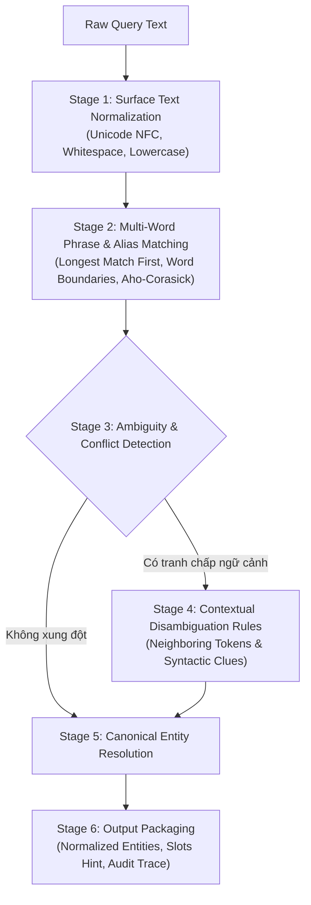
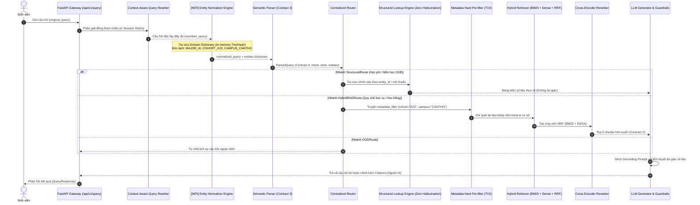

# KẾ HOẠCH TRIỂN KHAI KỸ THUẬT: HỆ THỐNG TỪ ĐIỂN MIỀN & CHUẨN HÓA THỰC THỂ HỌC VỤ
## (FPTUniQA Domain Dictionary & Entity Normalization System)

> **Tài liệu Kế hoạch Nghiên cứu & Thiết kế Kiến trúc (Research & Technical Planning Only)**  
> **Dự án:** FPT University Academic QA Chatbot (FPTUniQA)  
> **Tác giả:** Senior AI Engineer & Software Architect  
> **Thời điểm lập:** Tháng 11/2026  
> **Trạng thái:** DRAFT FOR REVIEW — KHÔNG THAY ĐỔI MÃ NGUỒN HIỆN TẠI

---

## MỤC LỤC
1. [Tóm tắt điều hành (Executive Summary)](#1-tóm-tắt-điều-hành-executive-summary)
2. [Kiểm toán kiến trúc hiện tại (Existing Architecture Audit)](#2-kiểm-toán-kiến-trúc-hiện-tại-existing-architecture-audit)
3. [Kiểm kê dữ liệu thực tế trong Repository (Repository Data Inventory)](#3-kiểm-kê-dữ-liệu-thực-tế-trong-repository-repository-data-inventory)
4. [Phạm vi và phân loại từ điển miền (Dictionary Scope & Categories)](#4-phạm-vi-và-phân-loại-từ-điển-miền-dictionary-scope--categories)
5. [Thiết kế Lược đồ Từ điển Miền (Proposed Dictionary Schema)](#5-thiết-kế-lược-đồ-từ-điển-miền-proposed-dictionary-schema)
6. [Thiết kế Động cơ Chuẩn hóa Thực thể (Entity Normalization Engine Design)](#6-thiết-kế-động-cơ-chuẩn-hóa-thực-thể-entity-normalization-engine-design)
7. [Kiến trúc Tích hợp và Luồng dữ liệu (Integration Architecture & Data Flow)](#7-kiến-trúc-tích-hợp-và-luồng-dữ-liệu-integration-architecture--data-flow)
8. [Ví dụ Kịch bản Đầu vào / Đầu ra (Example Input / Output Scenarios)](#8-ví-dụ-kịch-bản-đầu-vào--đầu-ra-example-input--output-scenarios)
9. [Chiến lược Kiểm thử và Đánh giá (Evaluation & Testing Strategy)](#9-chiến-lược-kiểm-thử-và-đánh-giá-evaluation--testing-strategy)
10. [Lộ trình Triển khai theo Giai đoạn (Implementation Roadmap)](#10-lộ-trình-triển-khai-theo-giai-đoạn-implementation-roadmap)
11. [Phân tích Rủi ro và Biện pháp Giảm thiểu (Risks & Mitigation)](#11-phân-tích-rủi-ro-và-biện-pháp-giảm-thiểu-risks--mitigation)
12. [Các Câu hỏi Mở và Quyết định Cần Con người Xác nhận (Open Questions & Decisions)](#12-các-câu-hỏi-mở-và-quyết-định-cần-con-người-xác-nhận-open-questions--decisions)

---

## 1. Tóm tắt điều hành (Executive Summary)

### 1.1. Bối cảnh dự án
Hệ thống **FPTUniQA** là chatbot RAG chuyên sâu phục vụ tư vấn quy chế đào tạo, chuẩn đầu ra, chương trình đào tạo, biểu phí và chính sách tuyển sinh cho sinh viên Đại học FPT. Bản demo hiện tại đã hoàn tất qua 6 tuần phát triển, đạt 79/79 bài test kiểm thử tích hợp và đơn vị (unit/integration tests) pass 100%, đồng thời giữ vững độ chính xác định tuyến (routing accuracy 100%) và không xảy ra ảo giác số học (zero numerical hallucination) trên bộ câu hỏi chuẩn `benchmark_100`.

### 1.2. Thách thức kỹ thuật nhận diện
Trong thực tế sử dụng của sinh viên:
1. **Đa dạng cách biểu đạt thực thể:** Sinh viên dùng nhiều cách gọi khác nhau cho cùng một khái niệm học vụ:
   - Ngành học: "AI", "A.I.", "Artificial Intelligence", "Trí tuệ nhân tạo", "tri tue nhan tao", "ngành AI".
   - Môn học: Sinh viên hỏi bằng tên tiếng Việt ("Cơ sở lập trình C", "Cấu trúc dữ liệu và giải thuật") thay vì mã môn chính thức (`PRF192`, `CSD201`).
   - Khóa học / Niên khóa: "K22", "Khóa 22", "Khóa K22", "sinh viên khóa 2026", "nhập học năm 2026".
   - Thuật ngữ học vụ: "TC" / "Tín chỉ", "Học phí" / "Tuition fee", "Tiên quyết" / "Prerequisite", "ĐATN" / "KLTN" / "Capstone".
2. **Hạn chế của kiến trúc hiện tại:**
   - Dữ liệu từ khóa và bí danh (aliases) bị phân tán, hardcode rời rạc trong các file code Python (`src/FPTUniQA/query/constants.py`, `campus_matcher.py`, `semantic_parser.py`, `router.py`, `structured.py`).
   - `normalize_query()` trong `normalizer.py` chỉ thực hiện chuẩn hóa Unicode NFC và gọt khoảng trắng thừa, hoàn toàn không có khả năng nhận diện hay chuẩn hóa thực thể.
   - Chưa có cơ chế phân giải ngữ cảnh (Context-aware Disambiguation) khi một từ viết tắt có thể mang nhiều nghĩa (ví dụ: "AI" vừa là ngành học, vừa là chủ đề công nghệ, vừa nằm trong tên một môn học).
   - Nguy cơ suy diễn vô căn cứ: Tự động giả định "năm 2026 = K22" trong mọi bối cảnh khi chưa có dữ liệu kiểm chứng sẽ dẫn đến sai lệch nghiêm trọng đối với các chương trình liên kết hoặc hệ thống khác.

### 1.3. Mục tiêu giải pháp đề xuất
Xây dựng phân hệ **FPTUniQA Domain Dictionary & Entity Normalization System** với 4 nguyên tắc cốt lõi:
1. **Nguồn chân lý duy nhất (Single Source of Truth - SSOT):** Tập trung toàn bộ thực thể học vụ vào các tệp từ điển có cấu trúc (YAML/JSON Schema validation), lưu vết nguồn gốc (provenance/evidence) từ chính 824 chunk tài liệu quy chế, 67 môn học CKB, 190 biểu phí cơ sở và 226 URL tuyển sinh crawled đã có trong kho dữ liệu.
2. **Quy tắc xác định trước (Deterministic First):** Ưu tiên đối sánh chuỗi xác định (Longest Match First, Word-Boundary Regex, Diacritic-Insensitive Mapping) với độ trễ siêu thấp (p95 ≤ 5ms), chỉ nhờ cậy Semantic Parser của LLM khi xảy ra tranh chấp ngữ cảnh hoặc câu hỏi mơ hồ.
3. **Bảo toàn tính bất biến của hệ thống hiện tại (Preserve Stable Demo):** Giữ nguyên vẹn 3 bản hợp đồng giao diện (`contracts.py` Contract 1, 2, 3), không thay đổi cấu hình gốc, không xóa bỏ logic hiện tại, bảo đảm 100% khả năng tương thích ngược.
4. **Không suy diễn ngoài dữ liệu (Grounding Principle):** Nếu một ánh xạ niên khóa hoặc thực thể không tìm thấy minh chứng trong tài liệu gốc, hệ thống giữ nguyên giá trị thô và đánh dấu trạng thái "chưa kiểm chứng" (unverified/ambiguous) thay vì phỏng đoán.

---

## 2. Kiểm toán kiến trúc hiện tại (Existing Architecture Audit)

Dưới đây là kết quả kiểm toán thực tế mã nguồn repository FPTUniQA (không dựa vào tài liệu cũ mà đối soát trực tiếp trên từng file code):

### 2.1. Cấu trúc thư mục tổng thể
```
FPTUniQA/
├── api/                        # FastAPI REST API endpoints & schemas
├── configs/                    # YAML configuration files (base, dev, prod, eval)
├── contracts.py                # Single Source of Truth cho 3 Data Contracts
├── data/
│   ├── raw/                    # Dữ liệu thu thập thô
│   ├── interim/                # Dữ liệu trung gian
│   ├── processed/              # Corpus JSONL, Metadata, CSDL JSON biểu phí & môn học
│   └── evaluation/             # Golden answers, benchmarks, test sets
├── docs/                       # Tài liệu kiến trúc, báo cáo phân tích, data contracts
├── experiments/                # Kết quả chạy thực nghiệm, ma trận ablation
├── fptuniqa_raw_crawler_starter/ # Bộ cào web dữ liệu tuyển sinh, zip backup & manifest
├── frontend/                   # Streamlit Web Application (app.py)
├── logs/                       # JSONL logging (pipeline_events, parsing_events)
├── notebooks/                  # Jupyter notebooks phân tích dữ liệu
├── scripts/                    # Scripts benchmark, ingestion, evaluation, regression
├── src/FPTUniQA/               # Mã nguồn lõi chia theo 7 tầng chức năng
└── tests/                      # Unit tests & Integration tests (79 test cases)
```

### 2.2. Kiểm toán chi tiết 18 thành phần hệ thống

| STT | Thành phần / Module | Đường dẫn tệp | Trách nhiệm chính | Đầu vào (Input) | Đầu ra (Output) | Cấu trúc dữ liệu & Lớp quan trọng | Phụ thuộc | Trạng thái hiện tại |
|---|---|---|---|---|---|---|---|---|
| 1 | **FastAPI Backend Gateway** | `api/main.py`, `api/routes/qa.py`, `health.py` | Tiếp nhận HTTP request, xác thực schema, rate limit, CORS, routing | `QueryRequest` (JSON) | `QueryResponse` (JSON) | `FastAPI`, `QueryRequest`, `QueryResponse`, `Citation` | `RAGPipeline`, `contracts.py` | Đã hoàn thiện (Production-ready) |
| 2 | **Web UI (Streamlit)** | `frontend/app.py` | Giao diện hỏi đáp hội thoại trực quan, hiển thị route badge, citations, latency | Chuỗi câu hỏi sinh viên | Giao diện Chatbot Streamlit | `st.session_state`, `requests` gọi API | `api/` hoặc direct pipeline | Đã hoàn thiện |
| 3 | **Contracts (Hợp đồng dữ liệu)** | `contracts.py` | Quy chuẩn hóa giao diện giữa các tầng theo 3 Contract | Dữ liệu thô từ các module | Pydantic Models | `QueryRequest`, `QueryResponse`, `DocumentChunk`, `ParsedQuery`, `Citation` | `pydantic` | Đã hoàn thiện (SSOT toàn hệ thống) |
| 4 | **Context Rewriter (Tuần 5)** | `src/FPTUniQA/query/rewriting.py` | Viết lại câu hỏi đa lượt, giải quyết đại từ chiếu vật và tỉnh lược | `query: str`, `history: List[Dict]` | `rewritten_query: str` | `rewrite_query()`, `detect_topic_switch()`, `CircuitBreaker` | LLM API, `constants.py` | Đã hoàn thiện |
| 5 | **Query Normalizer** | `src/FPTUniQA/query/normalizer.py` | Tiền xử lý văn bản câu hỏi trước khi xử lý | `text: str` | `clean_text: str` | `normalize_query()` (NFC, strip, whitespace collapse) | `unicodedata`, `re` | **Chỉ xử lý bề mặt, chưa có Dictionary** |
| 6 | **Campus Matcher** | `src/FPTUniQA/query/campus_matcher.py` | Nhận diện phân hiệu cơ sở từ câu hỏi | `text: str` | `campus_code: str` / `display_name: str` | `match_campus()`, `match_campus_code()`, `CampusCode` (Enum) | `re` | Đã hoàn thiện cho 5 campus (Hardcoded) |
| 7 | **Semantic Parser** | `src/FPTUniQA/query/semantic_parser.py` | Trích xuất Intent và Slots có cấu trúc (Contract 3) | `question: str`, `force_regex: bool` | `ParsedQuery` (Contract 3) | `parse_query()`, `_parse_with_llm()`, `_parse_with_regex()` | LLM API, `contracts.py`, `constants.py` | Đã hoàn thiện (Hybrid LLM + Regex) |
| 8 | **Centralized Router** | `src/FPTUniQA/query/router.py` | Điều phối truy vấn sang 1 trong 5 nhánh thực thi | `ParsedQuery`, `history` | `RouteResult` (route, clarification, level) | `route_query()`, `determine_query_level()` (Levels 1-10) | `contracts.py`, `structured.py` | Đã hoàn thiện |
| 9 | **Structured Lookup Engine** | `src/FPTUniQA/query/router.py`, `src/FPTUniQA/data/structured.py` | Tra cứu bảng biểu học phí, tín chỉ, CKB môn học xác định | `ParsedQuery` (slots) | `Dict[str, Any]` (answer, data, source) | `execute_structured_lookup()`, `StructuredDataParser` | `data/processed/structured_*.json` | Đã hoàn thiện (Zero Hallucination) |
| 10 | **Metadata Hard Pre-filter** | `src/FPTUniQA/retrieval/filter.py` | Lọc cứng tài liệu theo cohort, campus, category trước ranking | `doc: Dict`, `metadata_filter: Dict` | `bool` | `matches_metadata_filter()`, `_is_campus_match()` | `campus_matcher.py` | Đã hoàn thiện code lọc |
| 11 | **BM25 Retriever** | `src/FPTUniQA/retrieval/bm25.py` | Tìm kiếm từ khóa thưa kết hợp tách từ tiếng Việt | `query: str`, `top_k: int` | `List[Tuple[Dict, float]]` | `BM25Retriever`, `BM25Plus`, `pyvi.ViTokenizer` | `pyvi`, `rank_bm25` | Đã hoàn thiện |
| 12 | **Dense Vector Retriever** | `src/FPTUniQA/retrieval/dense.py`, `embedding.py` | Tìm kiếm ngữ nghĩa sâu bằng mô hình nhúng và FAISS | `query: str`, `top_k: int` | `List[Tuple[Dict, float]]` | `DenseRetriever`, `EmbeddingModel` (`multilingual-e5-base`), `faiss` | `faiss`, `sentence_transformers` | Đã hoàn thiện |
| 13 | **Reciprocal Rank Fusion (RRF)**| `src/FPTUniQA/retrieval/rrf.py` | Hợp nhất kết quả thứ hạng giữa BM25 và Dense Search | `ranked_runs: List`, `k: 60`, `weights` | `List[Tuple[Dict, float]]` | `reciprocal_rank_fusion()` | Built-in Python | Đã hoàn thiện |
| 14 | **Cross-Encoder Reranker** | `src/FPTUniQA/reranking/reranker.py`, `cross_encoder.py` | Tái xếp hạng cặp (query, candidate doc) bằng mô hình sâu | `query: str`, `documents: List[Dict]` | `List[Tuple[Dict, float]]` | `CrossEncoderReranker` (`bge-reranker-base`) | `sentence_transformers` | Đã hoàn thiện |
| 15 | **Context Builder & Citations** | `src/FPTUniQA/generation/context.py`, `citation.py` | Định dạng context [Nguồn N] và bóc tách trích dẫn | `retrieved_chunks: List[Dict]` | `final_context: str`, `List[Citation]` | `format_context()`, `extract_citations()` | `contracts.py`, `re` | Đã hoàn thiện |
| 16 | **LLM Generator & Guardrails** | `src/FPTUniQA/generation/llm.py`, `prompt.py`, `guardrails.py` | Sinh câu trả lời có căn cứ và kiểm duyệt ảo giác số liệu | `system_prompt`, `user_prompt` | `answer_text: str`, `possible_hallucination` | `LLMClient`, `build_prompt()`, `check_hallucination()` | OpenAI/Anthropic/Gemini API | Đã hoàn thiện |
| 17 | **RAG Pipeline Orchestrator** | `src/FPTUniQA/pipeline/rag_pipeline.py` | Điều phối tổng thể 7 bước từ Query đến Answer | `query: str`, `session_id: str` | `Dict[str, Any]` (answer, citations, route) | `RAGPipeline`, `SessionManager` | Tất cả các tầng | Đã hoàn thiện |
| 18 | **Framework Đánh giá & Log** | `src/FPTUniQA/evaluation/`, `src/FPTUniQA/utils/logger.py` | Ghi log JSONL có cấu trúc và tính toán các metrics học vụ | File log sự kiện, benchmark datasets | Metric scores (Precision, Recall, F1, Hallucination) | `Evaluator`, `retrieval_metrics`, `answer_metrics` | `sklearn`, `numpy` | Đã hoàn thiện |

### 2.3. Phát hiện bất đồng giữa tài liệu và mã nguồn thực tế (Discrepancy Report)
Trong quá trình audit trực tiếp mã nguồn, chúng tôi phát hiện 3 điểm bất đồng kỹ thuật quan trọng giữa tài liệu mô tả và code đang chạy:

> [!WARNING]
> **Điểm bất đồng 1: Bỏ sót Metadata Hard Pre-filter trong RAG Pipeline**  
> - *Tài liệu mô tả (`docs/report3.md` mục 3.1.4 & 3.3.4):* Hệ thống khẳng định áp dụng "Metadata Hard Pre-filtering" dựa trên slots `cohort`, `effective_date`, `campus` của Contract 3 để loại trừ tài liệu sai niên khóa trước khi tính véc-tơ tương đồng.  
> - *Mã nguồn thực tế (`rag_pipeline.py` dòng 234):* Hàm gọi `self.retriever.retrieve_contract2(clean_query, top_k=effective_top_k, rerank=...)` hoàn toàn **KHÔNG truyền tham số `metadata_filter`**, khiến cho việc lọc siêu dữ liệu bị bỏ qua trong flow RAG mặc định.  
> - *Giải pháp trong kế hoạch:* Khi tích hợp Entity Normalizer, các slots `cohort`, `campus` chuẩn hóa sẽ được đóng gói vào `metadata_filter` và truyền chính thức vào `retrieve_contract2`.

> [!NOTE]
> **Điểm bất đồng 2: Lệch cấu trúc lược đồ `structured_data.json`**  
> - *Tài liệu mô tả (`docs/data_schema.md` mục 2):* Mô tả trường dữ liệu bảng học phí là `tuition_table` và phí ký túc xá là `dormitory_fees`.  
> - *Mã nguồn thực tế (`data/processed/structured_data.json`):* Cấu trúc thực tế dùng khóa `fpt_cohort_fees` (biểu phí 6 khóa K17-K22), `tuition_flat_list` (190 dòng chi tiết), và `common_fees`. Mã nguồn trong `router.py` đọc đúng khóa thực tế, nhưng tài liệu schema chưa được cập nhật đồng bộ.

> [!NOTE]
> **Điểm bất đồng 3: Trường `entities` trong Contract 3 chưa được sử dụng**  
> - *Hợp đồng dữ liệu (`contracts.py`):* Đối tượng `ParsedQuery` đã được thiết kế sẵn trường `entities: Dict[str, Any]` và `normalized_query: Optional[str]`.  
> - *Mã nguồn thực tế (`semantic_parser.py`):* Cả nhánh LLM và Regex Fallback hiện mới chỉ trích xuất dữ liệu vào trường `slots`, để trống hoàn toàn `entities = {}`.  
> - *Cơ hội kiến trúc:* Chúng ta có thể tận dụng ngay trường `entities` sẵn có này để chứa kết quả chuẩn hóa từ Domain Dictionary mà không làm vỡ schema của bất kỳ module nào!

---

## 3. Kiểm kê dữ liệu thực tế trong Repository (Repository Data Inventory)

Chúng tôi đã quét và trích xuất toàn bộ dữ liệu có trong repository để lập danh mục thực thể học vụ có căn cứ (ground-truth):

### 3.1. Danh mục Ngành học và Mã ngành (Majors & Programs)
Dữ liệu được khai phá từ 3 nguồn: (1) `tuition_rates` và `tuition_flat_list` trong `structured_data.json`, (2) `structured_data_credits.json`, (3) CKB `structured_data_courses.json`:

* **13 Ngành đào tạo có mã chính thức theo quy chuẩn Bộ GD&ĐT (MOET Code):**
  1. `7480103`: Kỹ thuật Phần mềm (Software Engineering) — Khối CNTT
  2. `7480107`: Trí tuệ Nhân tạo (Artificial Intelligence) — Khối CNTT
  3. `7480202`: An toàn Thông tin (Information Assurance) — Khối CNTT
  4. `7480201`: Khoa học Máy tính (Computer Science) — Khối CNTT
  5. `7480104`: Hệ thống Thông tin (Information Systems) — Khối CNTT
  6. `7210403`: Thiết kế Mỹ thuật số (Digital Art & Design) — Khối Nghệ thuật số
  7. `7340101`: Quản trị Kinh doanh (Business Administration) — Khối Kinh tế
  8. `7340114`: Digital Marketing — Khối Kinh tế
  9. `7340120`: Kinh doanh Quốc tế (International Business) — Khối Kinh tế
  10. `7320104`: Truyền thông Đa phương tiện (Multimedia Communications) — Khối Truyền thông
  11. `7220201`: Ngôn ngữ Anh (English Language) — Khối Ngôn ngữ
  12. `7220209`: Ngôn ngữ Nhật (Japanese Language) — Khối Ngôn ngữ
  13. `7220210`: Ngôn ngữ Hàn Quốc (Korean Language) — Khối Ngôn ngữ

* **Các chuyên ngành và định hướng mới xuất hiện trong văn bản tuyển sinh 2026 (`f7edff91f24fbc25ad34b300.html`):**
  - Công nghệ ô tô số (Automotive)
  - Vi mạch bán dẫn (Semiconductor IC Design)
  - Khoa học dữ liệu và ứng dụng (Data Science)
  - Luật kinh tế / Luật
  - Tài chính ngân hàng / Công nghệ tài chính (Fintech)
  - Quản trị khách sạn / Quản trị dịch vụ Du lịch và Lữ hành

### 3.2. Danh mục Khóa học và Niên khóa (Cohorts & Admission Years)
Căn cứ vào metadata `effective_date`, tên tệp nguồn và nội dung tài liệu trong `data/processed/corpus.jsonl` và `data/raw/fpt_admission/`:

| Khóa (Cohort) | Năm tuyển sinh / Hiệu lực | Tài liệu nguồn minh chứng (Source Document) | Phạm vi cơ sở áp dụng | Trạng thái xác thực |
|---|---|---|---|---|
| **K17** | **2021** (2021-09-01) | `[studocu.com] - Sổ Tay Sinh Viên K17 - Đại Học FPT - Hướng Dẫn Chi Tiết Và Thông Tin.pdf` | HN / ALL | **Verified (repo data)** |
| **K18** | **2022** (2022-09-01) | `sotaysinhvienK18HN.pdf` | HN / ALL | **Verified (repo data)** |
| **K19** | **2023** (2023-09-01) | `[studocu.com] - Hướng dẫn Tài chính Sinh viên K19 - Quy định và Phí năm học 2023-2024.pdf`| ALL | **Verified (repo data)** |
| **K20** | **2024** (2024-09-01) | `1054154482-K20-Sổ-Tay-Sinh-Vien-2.pdf` | ALL | **Verified (repo data)** |
| **K21** | **2025** (2025-09-01) | `970569429-So-Tay-Sinh-Vien-K21-FUHL-1.pdf` | FUHL / ALL | **Verified (repo data)** |
| **K22** | **2026** (2026-09-01) | `2026_So-tay-k22_compressed.pdf` & Thông báo tuyển sinh 2026 (`f7edff91f24fbc25ad34b300.html`) | HCM / HN / ALL | **Verified (repo data)** |

> [!IMPORTANT]
> **Bằng chứng xác thực K22 = Năm 2026:**
> Trích đoạn trực tiếp từ trang HTML thông báo tuyển sinh năm 2026 của trường Đại học FPT:
> - *"Tất cả các thí sinh khóa K22 nhập học vào Trường Đại học FPT năm 2026."*
> - *"6 điều thầy Hiệu trưởng Trường Đại học FPT nhắn gửi tới tân sinh viên K22 tại Lễ khai giảng..."*
> - Tệp tài liệu: `2026_So-tay-k22_compressed.pdf` gắn nhãn `effective_date: 2026-09-01`, `applies_to_cohort: ["K22"]`.
> 
> **Quy tắc bất biến:**
> Ánh xạ 2026 ↔ K22 được xác nhận 100% trong miền dữ liệu Đại học FPT chính quy. TUY NHIÊN, đối với các năm khác (ví dụ: 2027, 2028) hoặc các hệ đào tạo khác chưa có văn bản chính thức trong repo, hệ thống **tuyệt đối không được tự động suy diễn** 2027 là K23 hay 2028 là K24. Phải giữ nguyên giá trị chuỗi năm và gán cờ `unresolved_cohort = True`.

### 3.3. Danh mục Môn học (Courses & CKB)
Kho tri thức chương trình đào tạo `structured_data_courses.json` chứa **67 môn học** với cấu trúc hoàn chỉnh:
- **Nhóm nòng cốt CNTT:** `PRF192` (Cơ sở lập trình C), `PRO192` (Lập trình hướng đối tượng với Java), `CSD201` (Cấu trúc dữ liệu và giải thuật), `DBI202` (Cơ sở dữ liệu), `OSG202` (Hệ điều hành), `NWC203c` (Mạng máy tính), `SWE201c` (Nhập môn kỹ thuật phần mềm), `PRJ301` (Lập trình Web Java), `PRN211` (Lập trình .NET), `SWP391` (Dự án phần mềm), `SWT301` (Kiểm thử phần mềm), `SWD392` (Kiến trúc & thiết kế phần mềm), `SEP490` (Khóa luận tốt nghiệp KTPM).
- **Nhóm Trí tuệ nhân tạo (AI):** `AIL302m` (Học máy - Machine Learning), `NLP301c` (Xử lý ngôn ngữ tự nhiên), `CVL301c` (Thị giác máy tính), `DLG301` (Học sâu), `AIP391` (Dự án AI), `AIP490` (Khóa luận tốt nghiệp AI).
- **Nhóm An toàn thông tin (ATTT):** `CRY301` (Mật mã học), `IAL201` (An toàn hệ thống và mạng), `IAR301` (Ứng cứu sự cố an ninh), `FOR301` (Điều tra số - Forensics), `IAP490` (Khóa luận tốt nghiệp ATTT).
- **Nhóm Kinh tế & Marketing:** `MKT101` (Nguyên lý Marketing), `MGT103` (Nhập môn Quản trị), `ECO111` (Kinh tế vi mô), `ECO121` (Kinh tế vĩ mô), `ACC101` (Nguyên lý kế toán), `FIN202` (Tài chính doanh nghiệp), `OBE102` (Hành vi tổ chức), `MKP391`, `BAP490`.
- **Nhóm Mỹ thuật số & Đồ họa:** `DGT101` (Nhập môn Thiết kế đồ họa), `VWS101` (Nghệ thuật thị giác), `GRA201` (Đồ họa 2D), `TYP201` (Nghệ thuật chữ), `ANM301` (Hoạt hình 2D/3D), `GDP490` (Đồ án tốt nghiệp Mỹ thuật số).
- **Nhóm Ngoại ngữ & Khác:** `ENG101`, `ENG102`, `JAP101`, `KOR101`, `VOV114` (Võ Vovinam 1), `VOV124` (Võ Vovinam 2), `VOV134` (Vovinam 3), `MIL111`, `MIL121` (GDQP), `SSL101c` (Kỹ năng học tập đại học), `EXE101`, `EXE201` (Trải nghiệm khởi nghiệp).

### 3.4. Danh mục Cơ sở / Phân hiệu (Campuses)
Đối soát từ `campus_matcher.py` và `structured_data.json`:
1. `HANOI` (Tên chuẩn: "Hà Nội"; Viết tắt/Aliases: "hn", "fuhl", "hòa lạc", "hoa lac", "hanoi", "hl")
2. `HCM` (Tên chuẩn: "TP. Hồ Chí Minh"; Viết tắt/Aliases: "tp. hcm", "tp hcm", "hồ chí minh", "ho chi minh", "hcm", "tphcm", "sài gòn", "sai gon", "quận 9")
3. `DANANG` (Tên chuẩn: "Đà Nẵng"; Viết tắt/Aliases: "đà nẵng", "da nang", "danang", "đn", "dn")
4. `CANTHO` (Tên chuẩn: "Cần Thơ"; Viết tắt/Aliases: "cần thơ", "can tho", "cantho", "ct")
5. `QUYNHON` (Tên chuẩn: "Quy Nhơn"; Viết tắt/Aliases: "quy nhơn", "quy nhon", "quynhon", "bình định", "binh dinh", "qn")
6. `ALL` (Áp dụng toàn quốc / chung cho tất cả các cơ sở)

### 3.5. Danh mục Thuật ngữ Học vụ & Quy chế (Academic Terminology)
Trích xuất từ quy chế học vụ và bài test:
- **Tín chỉ & Học phần:** Tín chỉ (TC, credit, credits), học phần (course, subject), môn tiên quyết (prerequisite), môn song hành (corequisite), học cải thiện, học vượt, miễn giảm học phần, bảo lưu kết quả.
- **Biểu phí & Tài chính:** Học phí (tuition fee), học phí chuyên ngành, học phí tiếng Anh chuẩn bị (prep English), lệ phí thi lại (retake exam fee - 300.000 VNĐ), lệ phí học lại (relearn fee - 650.000 VNĐ/tín chỉ), phí ký túc xá (dormitory fee - 4.000.000 VNĐ/kỳ tại Hòa Lạc), lệ phí cấp bằng / tốt nghiệp (1.500.000 VNĐ), học phí kỳ thực tập doanh nghiệp (OJT - 0 VNĐ học phí chuyên ngành).
- **Đánh giá & Thang điểm:** Điểm GPA, CGPA, điểm trung bình học kỳ, điểm tổng kết môn, điểm F, điểm liệt, thi PE (Practical Exam - thi thực hành), thi EOS (End of Semester - thi kết thúc kỳ), kiểm tra tiến trình (progress test, assignment), phúc khảo bài thi.
- **Kỷ luật & Cảnh báo:** Cảnh báo học vụ (disciplinary warning / academic warning), buộc thôi học (dismissal / expulsion), đình chỉ học tập, vi phạm quy chế thi, tỷ lệ vắng mặt (chuyên cần > 20% bị cấm thi).
- **Tốt nghiệp & Chuẩn đầu ra:** Điều kiện tốt nghiệp (graduation requirements), đồ án tốt nghiệp / khóa luận tốt nghiệp (Capstone Project / SEP490 / AIP490), chuẩn ngoại ngữ (IELTS 5.5 / TOEFL / VSTEP / TOEIC), chứng chỉ Giáo dục thể chất (Vovinam 3 cấp độ), chứng chỉ Giáo dục quốc phòng (GDQP).

---

## 4. Phạm vi và phân loại từ điển miền (Dictionary Scope & Categories)

Thay vì tổ chức một tệp dữ liệu khổng lồ khó bảo trì, hệ thống từ điển miền sẽ được module hóa thành **6 tệp JSON/YAML độc lập**, phân tách ranh giới rõ ràng theo chức năng nghiệp vụ, đặt trong thư mục `data/dictionary/`:

```
data/dictionary/
├── schema.json                 # JSON Schema quy định chuẩn cấu trúc validation
├── majors.json                 # Danh mục ngành đào tạo, chuyên ngành, mã MOET
├── courses.json                # Danh mục 67 môn học CKB, mã môn, tên Anh/Việt
├── cohorts.json                # Danh mục khóa tuyển sinh K17-K22, năm nhập học
├── campuses.json               # Danh mục phân hiệu cơ sở, mã ký hiệu
├── academic_terms.json         # Danh mục thuật ngữ học vụ, quy chế, biểu phí
└── abbreviations.json          # Bảng tra cứu chữ viết tắt học vụ phổ biến
```

### Chi tiết phạm vi từng tệp:
1. `majors.json`: Quản lý 13 ngành chính thức + các chuyên ngành mới. Khắc phục triệt để tình trạng phân mảnh casing ("Trí tuệ nhân tạo" vs "Trí tuệ Nhân tạo") và các biến thể không dấu.
2. `courses.json`: Đồng bộ hoàn toàn từ `structured_data_courses.json`. Mỗi môn học có danh sách aliases gồm cả tên tiếng Việt, tên tiếng Anh, tên viết tắt ("CTDL&GT", "OOP", "Nhap mon C").
3. `cohorts.json`: Định nghĩa chuẩn khóa K17 - K22 kèm năm nhập học chính xác, liên kết nguồn gốc tài liệu văn bản. Cấm suy diễn các khóa tương lai khi chưa có thông báo tuyển sinh trong repo.
4. `campuses.json`: Đồng bộ từ `campus_matcher.py` để trở thành SSOT duy nhất về phân hiệu, hỗ trợ cả mã viết tắt sân bay/hành chính (HN, HCM, DN, CT, QN).
5. `academic_terms.json`: Chuẩn hóa các thuật ngữ nghiệp vụ học vụ sang các concept code (ví dụ: `CONCEPT_CANH_BAO_HOC_VU`, `CONCEPT_TIN_CHI`, `CONCEPT_OJT`).
6. `abbreviations.json`: Bảng mở rộng từ viết tắt nhanh (sinh viên gõ nhanh "sv", "tc", "k20", "gpa", "ktpm").

---

## 5. Thiết kế Lược đồ Từ điển Miền (Proposed Dictionary Schema)

Mỗi thực thể trong từ điển bắt buộc phải tuân thủ Schema chuẩn hóa cao, bảo đảm tính xác thực, khả năng truy vết và hỗ trợ phân giải tranh chấp ngữ cảnh:

```json
{
  "$schema": "http://json-schema.org/draft-07/schema#",
  "title": "FPTUniQA Entity Schema",
  "type": "object",
  "required": [
    "entity_id",
    "entity_type",
    "canonical_name",
    "canonical_name_vi",
    "aliases",
    "status",
    "verified",
    "confidence",
    "source_reference"
  ],
  "properties": {
    "entity_id": {
      "type": "string",
      "description": "Mã định danh duy nhất không đổi, viết hoa, phân cách bằng dấu gạch dưới (VD: MAJOR_AI, COURSE_PRF192, COHORT_K22, CAMPUS_CANTHO)"
    },
    "entity_type": {
      "type": "string",
      "enum": ["major", "course", "cohort", "campus", "academic_term", "abbreviation"]
    },
    "code": {
      "type": "string",
      "description": "Mã nghiệp vụ chính thức (Mã môn học: PRF192, Mã Bộ GD&ĐT: 7480107, Mã cơ sở: CANTHO)"
    },
    "canonical_name": {
      "type": "string",
      "description": "Tên chuẩn hóa bằng tiếng Anh hoặc danh xưng quốc tế"
    },
    "canonical_name_vi": {
      "type": "string",
      "description": "Tên chuẩn hóa tiếng Việt chính thức có dấu, đúng chính tả học vụ"
    },
    "aliases": {
      "type": "array",
      "items": { "type": "string" },
      "description": "Danh sách tất cả các biến thể từ đồng nghĩa, từ viết tắt, tiếng Việt không dấu, lỗi gõ phổ biến"
    },
    "status": {
      "type": "string",
      "enum": ["active", "deprecated", "provisional"]
    },
    "verified": {
      "type": "boolean",
      "description": "True nếu thực thể được xác nhận bởi tài liệu quy chế trong repository; False nếu suy đoán hoặc tạm thời"
    },
    "confidence": {
      "type": "number",
      "minimum": 0.0,
      "maximum": 1.0,
      "description": "Hệ số tin cậy của thực thể (1.0 cho dữ liệu verified)"
    },
    "source_reference": {
      "type": "object",
      "properties": {
        "file": { "type": "string" },
        "section": { "type": "string" },
        "url": { "type": "string" }
      },
      "required": ["file"]
    },
    "valid_from": {
      "type": "string",
      "format": "date",
      "description": "Ngày bắt đầu có hiệu lực (VD: 2026-09-01)"
    },
    "valid_to": {
      "type": "string",
      "format": "date",
      "description": "Ngày hết hiệu lực (nếu có)"
    },
    "disambiguation_rules": {
      "type": "object",
      "description": "Các quy tắc giải quyết đa nghĩa ngữ cảnh (Contextual disambiguation)"
    },
    "notes": {
      "type": "string"
    }
  }
}
```

### Ví dụ bản ghi thực tế:

```json
{
  "entity_id": "MAJOR_AI",
  "entity_type": "major",
  "code": "7480107",
  "canonical_name": "Artificial Intelligence",
  "canonical_name_vi": "Trí tuệ nhân tạo",
  "aliases": [
    "ai",
    "a.i.",
    "trí tuệ nhân tạo",
    "tri tue nhan tao",
    "ngành ai",
    "ngành trí tuệ nhân tạo",
    "chuyên ngành ai",
    "chuyên ngành trí tuệ nhân tạo",
    "tri tue nhan tao va khoa hoc du lieu"
  ],
  "status": "active",
  "verified": true,
  "confidence": 1.0,
  "source_reference": {
    "file": "data/processed/structured_data.json",
    "section": "tuition_rates"
  },
  "valid_from": "2021-09-01",
  "valid_to": null,
  "disambiguation_rules": {
    "prefer_course_if_preceded_by": ["môn", "học môn", "mã môn", "giáo trình môn"],
    "prefer_major_if_preceded_by": ["ngành", "chuyên ngành", "khoa", "học ngành"]
  },
  "notes": "Mã ngành chuẩn Bộ GD&ĐT: 7480107, thuộc khoa Công nghệ Thông tin"
}
```

---

## 6. Thiết kế Động cơ Chuẩn hóa Thực thể (Entity Normalization Engine Design)

Động cơ chuẩn hóa thực thể (`EntityNormalizer`) được thiết kế theo mô hình xử lý đường ống phân cấp (Multi-stage Pipeline) bảo đảm tính xác định (deterministic), không phụ thuộc vào thêm một lời gọi LLM tốn kém:



### 6.1. Chi tiết các giai đoạn xử lý:

#### Giai đoạn 1: Chuẩn hóa bề mặt văn bản (Surface Normalization)
- Giữ nguyên văn bản gốc (`original_query`).
- Chuẩn hóa Unicode NFC để xử lý các bộ gõ tiếng Việt gõ tổ hợp (NFD) thành dựng sẵn (NFC).
- Gọt khoảng trắng dư thừa, đưa về khoảng trắng đơn chuẩn.
- Tạo bản sao `q_lower` và `q_no_accent` (bản loại bỏ dấu thanh tiếng Việt) phục vụ tìm kiếm mềm.

#### Giai đoạn 2: Đối sánh Alias đa từ (Longest Match First Matching)
- **Thuật toán Khớp từ dài nhất trước (Longest Match First):** Sắp xếp toàn bộ aliases của từ điển theo số lượng token và độ dài ký tự giảm dần.
- Ví dụ: Chuỗi "ngành kỹ thuật phần mềm" sẽ được đối sánh toàn cụm trước, tránh bị phân tách thành "kỹ thuật" và "phần mềm" riêng rẽ.
- **Ranh giới từ bắt buộc (`\b...\b`):** Ngăn chặn hiện tượng match nhầm chuỗi con (substring false positive). Ví dụ: từ "ai" trong câu "Ai là hiệu trưởng?" KHÔNG được nhận diện nhầm thành ngành `MAJOR_AI`. Quy tắc regex: `r"(?<!\w)ai(?!\w)"` kết hợp kiểm tra từ đứng trước.

#### Giai đoạn 3 & 4: Giải quyết xung đột ngữ cảnh (Contextual Disambiguation)
Khi một từ khóa có thể thuộc về nhiều thực thể khác nhau:
1. **Từ "AI":**
   - Nếu đứng sau các từ chỉ thị ngành: `ngành`, `chuyên ngành`, `học phí ngành`, `điểm chuẩn ngành` → Phân giải về `MAJOR_AI` (`entity_type: major`).
   - Nếu đứng sau các từ chỉ thị môn học: `môn`, `học phần`, `giáo trình môn`, `tiên quyết môn` → Phân giải về môn học liên quan (ví dụ: `AIL302m` hoặc `AIP391`).
   - Nếu đi cùng các từ chung chung: "trí tuệ nhân tạo đang phát triển" → Đánh dấu `ambiguous: true`, không ép buộc gán vào slot tra cứu học phí.
2. **Khóa học và Năm (2026 vs K22):**
   - Nếu câu hỏi chứa "2026", tra cứu `cohorts.json`: "2026" ↔ `COHORT_K22` (Verified).
   - Nếu câu hỏi chứa "2028", tra cứu `cohorts.json`: Chưa có mapping → Giữ nguyên chuỗi "2028", gán `verified: false`, không tự động convert thành K24.

#### Giai đoạn 5 & 6: Đóng gói đầu ra chuẩn (Normalization Output Structure)
Đầu ra của `EntityNormalizer` là một đối tượng `NormalizationResult` gồm:
- `original_query`: Câu hỏi nguyên bản.
- `normalized_query`: Câu hỏi sau khi đã thay thế các từ viết tắt an toàn.
- `entities`: Danh sách các đối tượng thực thể nhận diện:
  + `entity_id`: Ví dụ `MAJOR_AI`
  + `entity_type`: `major`
  + `canonical_name`: `Artificial Intelligence`
  + `canonical_name_vi`: `Trí tuệ nhân tạo`
  + `matched_alias`: `ngành ai`
  + `span`: `(8, 16)` (Vị trí ký tự trong câu)
  + `confidence`: `1.0`
  + `verified`: `true`
- `detected_slots`: Dict tiện ích ánh xạ sẵn sang cấu trúc Contract 3 (`program`, `cohort`, `campus`, `course_code`).

---

## 7. Kiến trúc Tích hợp và Luồng dữ liệu (Integration Architecture & Data Flow)

### 7.1. Vị trí tích hợp tối ưu trong Pipeline FPTUniQA

Chúng tôi tiến hành phân tích 2 vị trí khả dĩ để đặt `Entity Normalization System`:
- *Vị trí A: Đặt trước Query Rewriting.*
  - *Nhược điểm:* Câu hỏi ở lượt 2, lượt 3 thường bị tỉnh lược ("còn năm 2023 thì sao?"). Nếu chuẩn hóa trước khi rewriter phục hồi ngữ cảnh, thực thể ngành học của lượt 1 sẽ không được nhận diện, dẫn đến thiếu slot.
- *Vị trí B: Đặt ngay sau Query Rewriting và ngay trước Semantic Parser (ĐƯỢC LỰA CHỌN).*
  - *Ưu điểm vượt trội:* 
    1. Query Rewriter đã phục hồi trọn vẹn ngữ cảnh thành câu hỏi độc lập (`rewritten_query`).
    2. Entity Normalizer tiếp nhận câu hỏi hoàn chỉnh, bóc tách toàn bộ thực thể (`program`, `cohort`, `campus`, `course_code`).
    3. Kết quả chuẩn hóa được đưa thẳng vào `ParsedQuery.entities` và hỗ trợ cả nhánh `LLM Structured Output` lẫn `Regex Fallback` của Semantic Parser mà không phải viết lại logic trích xuất slot.

### 7.2. Sơ đồ dòng dữ liệu tích hợp End-to-End



### 7.3. Đánh giá tính tương thích ngược (Backward Compatibility)
- **Contract 1 (API & Generation):** Hoàn toàn giữ nguyên. `QueryRequest` và `QueryResponse` không bị biến động.
- **Contract 2 (Retrieval):** Hoàn toàn giữ nguyên. `DocumentChunk` và `RetrievalResponse` giữ nguyên trường.
- **Contract 3 (Semantic Parsing):** Tận dụng trường `entities: Dict[str, Any]` sẵn có trong `ParsedQuery`. Các downstream modules (như Router, Evaluator) nếu chưa đọc `entities` vẫn hoạt động bình thường qua trường `slots`.

---

## 8. Ví dụ Kịch bản Đầu vào / Đầu ra (Example Input / Output Scenarios)

### Kịch bản 1: Chuẩn hóa ngành học và biến thể đồng nghĩa
- **Câu hỏi của sinh viên:** `"Học phí ngành tri tue nhan tao ở cơ sở ct khoá 2026 bao nhiêu?"`
- **Sau Query Rewriter:** `"Học phí ngành tri tue nhan tao ở cơ sở ct khoá 2026 là bao nhiêu?"`
- **Đầu ra của Entity Normalizer:**
  ```json
  {
    "detected_entities": [
      {
        "entity_id": "MAJOR_AI",
        "entity_type": "major",
        "canonical_name": "Artificial Intelligence",
        "canonical_name_vi": "Trí tuệ nhân tạo",
        "matched_alias": "tri tue nhan tao",
        "verified": true,
        "confidence": 1.0
      },
      {
        "entity_id": "CAMPUS_CANTHO",
        "entity_type": "campus",
        "canonical_name": "Can Tho Campus",
        "canonical_name_vi": "Cần Thơ",
        "matched_alias": "ct",
        "verified": true,
        "confidence": 1.0
      },
      {
        "entity_id": "COHORT_K22",
        "entity_type": "cohort",
        "canonical_name": "Cohort 22 (2026)",
        "canonical_name_vi": "Khóa 22 (Nhập học năm 2026)",
        "matched_alias": "khoá 2026",
        "verified": true,
        "confidence": 1.0
      }
    ],
    "slots_hint": {
      "program": "AI",
      "campus": "Cần Thơ",
      "cohort": "K22"
    }
  }
  ```
- **Hành vi Router & Structured Lookup:** Đủ 3 slots chuẩn hóa → Điều hướng sang `StructuredRoute` → Tra cứu biểu phí K22 tại Cần Thơ (được hưởng ưu đãi 30% toàn khóa) → Trả về đáp án chính xác 100%, không ảo giác.

### Kịch bản 2: Năm nhập học ngoài vùng dữ liệu kiểm chứng
- **Câu hỏi của sinh viên:** `"Học phí ngành CNTT cho sinh viên nhập học năm 2029 là bao nhiêu?"`
- **Đầu ra của Entity Normalizer:**
  ```json
  {
    "detected_entities": [
      {
        "entity_id": "MAJOR_CNTT",
        "entity_type": "major",
        "canonical_name_vi": "Công nghệ thông tin",
        "verified": true
      },
      {
        "entity_id": "RAW_YEAR_2029",
        "entity_type": "cohort",
        "canonical_name": "2029",
        "matched_alias": "nhập học năm 2029",
        "verified": false,
        "confidence": 0.4,
        "notes": "Chưa có văn bản quy chế hoặc quyết định biểu phí chính thức cho năm 2029 trong repository"
      }
    ]
  }
  ```
- **Hành vi Router:** Nhận diện slot `cohort` chưa được verified → Không ép về K25 → Điều hướng sang `rag_pipeline` hoặc phản hồi thông báo: *"Hiện tại nhà trường chưa ban hành biểu phí tuyển sinh chính thức cho năm 2029. Dưới đây là khung học phí khóa gần nhất (K22 - 2026)..."*

### Kịch bản 3: Tên môn học tiếng Việt không có mã môn
- **Câu hỏi của sinh viên:** `"Môn Cơ sở lập trình C học những nội dung gì và có mấy tín chỉ?"`
- **Đầu ra của Entity Normalizer:**
  ```json
  {
    "detected_entities": [
      {
        "entity_id": "COURSE_PRF192",
        "entity_type": "course",
        "code": "PRF192",
        "canonical_name": "C Programming Fundamentals",
        "canonical_name_vi": "Cơ sở lập trình C",
        "matched_alias": "Cơ sở lập trình C",
        "verified": true,
        "confidence": 1.0
      }
    ],
    "slots_hint": {
      "course_code": "PRF192",
      "course_aspect": "syllabus"
    }
  }
  ```
- **Hành vi Router & Structured Lookup:** `course_code: PRF192` được kích hoạt tự động → Gọi CKB tra cứu `syllabus` và `credits` môn PRF192 → Trả về 7 chủ đề trọng tâm và 3 tín chỉ với nguồn trích dẫn Curriculum Knowledge Base.

---

## 9. Chiến lược Kiểm thử và Đánh giá (Evaluation & Testing Strategy)

Theo tham vấn chuyên môn từ Cố vấn Chiến lược Claude, tiêu chí nghiệm thu được tổ chức thành **4 tầng kiểm soát chất lượng**:

### 9.1. Khung 4 tầng tiêu chí nghiệm thu (Acceptance Criteria)

| Tầng kiểm soát | Tiêu chí kỹ thuật | Chỉ số đo lường (Metric) | Ngưỡng chấp nhận (Threshold) | Phương pháp kiểm thử |
|---|---|---|---|---|
| **Lớp 1: Dữ liệu Từ điển** | Độ bao phủ thực thể (Coverage) | % thực thể trong `benchmark_100` có mặt trong từ điển | **≥ 98%** (100% P0: programs, campuses, fees, CKB courses) | Script kiểm toán tự động |
| | Tính chính xác mapping alias | Tỷ lệ ánh xạ alias → canonical entity đúng | **≥ 99%** | Audit thủ công trên mẫu ngẫu nhiên ≥ 100 alias |
| | Schema Validation | Tuân thủ định dạng JSON Schema | **100% Pass** | CI/CD Linter kiểm tra cấu trúc |
| | Tính truy vết nguồn gốc (Freshness) | % thực thể P0 có trường `source_reference` | **100%** | Kiểm tra trường bắt buộc |
| **Lớp 2: Pipeline Chuẩn hóa** | Tính xác định (Determinism) | Cùng input đầu vào → Cùng canonical form | **100%** | Unit test 10 lần lặp |
| | Tính lũy thừa (Idempotency) | Chuẩn hóa(Chuẩn hóa(x)) == Chuẩn hóa(x) | **100%** | Unit test tự động |
| | Precision & Recall | Đo trên Golden Set (300 câu gán nhãn) | **Precision ≥ 98%, Recall ≥ 95%** | Script benchmark chuyên biệt |
| | Độ trễ xử lý (Latency) | Thời gian xử lý p95 của normalizer | **≤ 5ms trên CPU** | Benchmark latency 10.000 lượt |
| | Fallback an toàn | Khi confidence thấp → gán `unresolved`, không đoán | **100%** | Adversarial test suite |
| **Lớp 3: Tích hợp QA (E2E)** | **Regression Gate tuyệt đối** | Độ chính xác routing, OOD, và hallucination rate | **KHÔNG SUY GIẢM so với baseline** (100% routing, 100% OOD, 0% hallucination) | Chạy toàn bộ `benchmark_100.jsonl` và 79 unit tests |
| | Không trôi niên khóa (Cohort Drift) | Tỷ lệ truy xuất đúng văn bản theo khóa | **100%** | Retrieval accuracy test |
| **Lớp 4: Governance & Vận hành** | Khả năng mở rộng & Rollback | Thời gian rollback khi từ điển có lỗi | **< 15 phút** | Thao tác git revert YAML |

### 9.2. Thiết kế các bộ kiểm thử chuyên biệt (Test Suites)

1. **Bộ kiểm thử từ đồng nghĩa (Synonym Recognition Test Suite):**
   - Đảm bảo 10 biến thể của AI ("AI", "A.I.", "Trí tuệ nhân tạo", "tri tue nhan tao", "nganh ai"...) đều hội tụ về `MAJOR_AI`.
   - Đảm bảo các cách gọi môn học tiếng Việt ("Cơ sở lập trình C", "Lập trình C", "C Programming") đều trỏ về `PRF192`.
2. **Bộ kiểm thử niên khóa (Cohort & Admission Year Test Suite):**
   - K17..K22 ánh xạ chính xác 2021..2026.
   - Các năm 2027, 2028, 2029 hoặc các khóa không có căn cứ: Kiểm tra hệ thống KHÔNG tự ý suy diễn.
3. **Bộ kiểm thử phân giải đa nghĩa (Disambiguation Test Suite):**
   - Phân biệt từ "AI" trong "môn AI" vs "ngành AI".
   - Phân biệt "Luật" chung vs "Luật kinh tế" tại các phân hiệu.
4. **Bộ kiểm thử đối kháng (Adversarial & Negative Test Suite):**
   - Từ khóa xuất hiện dưới dạng chuỗi con trong từ không liên quan (ví dụ: "mai", "lai", "tai" không được match nhầm thành "ai").
   - Câu hỏi chứa các trường đại học khác (Bách Khoa, Quốc Gia) → Bắt buộc giữ nguyên để Router đẩy vào OOD.

---

## 10. Lộ trình Triển khai theo Giai đoạn (Implementation Roadmap)

Lộ trình được chia thành 7 mốc triển khai (Milestones M0 - M6), bảo đảm tính tuần tự, an toàn và dễ dàng kiểm soát rủi ro:

```mermaid
gantt
    title Lộ trình Triển khai Hệ thống Từ điển Miền FPTUniQA
    dateFormat  YYYY-MM-DD
    section Khởi động & Chuẩn bị
    M0: Audit dữ liệu & Phê duyệt Kế hoạch     :done, m0, 2026-11-02, 1d
    M1: Schema & Trích xuất dữ liệu gốc       :active, m1, 2026-11-03, 3d
    section Xây dựng Lõi
    M2: Kiểm định, Khử trùng lặp & Linting     :m2, after m1, 2d
    M3: Động cơ Chuẩn hóa Entity Normalizer    :m3, after m2, 3d
    section Tích hợp & Kiểm thử
    M4: Tích hợp Semantic Parser & Router     :m4, after m3, 2d
    M5: Tích hợp Retrieval & Structured Lookup :m5, after m4, 2d
    M6: Benchmark Hồi quy & Đóng gói Tài liệu :m6, after m5, 3d
```

### M0: Repository and Data Audit (ĐÃ HOÀN THÀNH TẠI TÀI LIỆU NÀY)
- **Mục tiêu:** Kiểm toán toàn diện 18 thành phần mã nguồn, dữ liệu thực tế và lập kế hoạch kỹ thuật chi tiết.
- **Tài liệu tạo ra:** `docs/domain_dictionary_implementation_plan.md`.
- **Tác động mã nguồn:** Không thay đổi bất kỳ file mã nguồn nào.

### M1: Dictionary Schema and Initial Data Extraction
- **Mục tiêu:** Xây dựng JSON Schema và trích xuất dữ liệu thực tế có trong repo ra 6 tệp từ điển JSON/YAML.
- **Tệp tạo mới:**
  - `data/dictionary/schema.json`
  - `data/dictionary/majors.json`
  - `data/dictionary/courses.json`
  - `data/dictionary/cohorts.json`
  - `data/dictionary/campuses.json`
  - `data/dictionary/academic_terms.json`
  - `data/dictionary/abbreviations.json`
- **Tiêu chí nghiệm thu:** 100% các tệp từ điển pass `jsonschema` validator; 13 ngành có mã MOET, 67 môn CKB, 6 khóa K17-K22 được trích xuất đầy đủ kèm `source_reference`.

### M2: Dictionary Validation, Deduplication and Curation
- **Mục tiêu:** Kiểm tra xung đột khóa, khử trùng lặp aliases, loại bỏ alias gây nhiễu, biên soạn quy tắc phân giải ngữ cảnh.
- **Tệp tạo mới:** `scripts/lint_dictionary.py` (Script CI kiểm tra trùng lặp aliases giữa các thực thể).
- **Tiêu chí nghiệm thu:** 0 lỗi alias collision; 100% alias được gắn nhãn tin cậy.

### M3: Entity Normalization Engine Implementation
- **Mục tiêu:** Cài đặt module chuẩn hóa thực thể độc lập, xử lý Longest-Match-First và Trie in-memory.
- **Tệp tạo mới:**
  - `src/FPTUniQA/normalization/__init__.py`
  - `src/FPTUniQA/normalization/engine.py`
  - `src/FPTUniQA/normalization/trie.py`
  - `tests/unit/test_entity_normalizer.py`
- **Tiêu chí nghiệm thu:** Unit tests cho normalizer pass 100%; p95 latency ≤ 5ms.

### M4: Integration with Semantic Parser and Centralized Router
- **Mục tiêu:** Kết nối Normalizer vào luồng xử lý giữa Query Rewriter và Semantic Parser; điền dữ liệu vào `ParsedQuery.entities`.
- **Tệp cập nhật:**
  - `src/FPTUniQA/pipeline/rag_pipeline.py` (Gọi Normalizer sau `rewrite_query`)
  - `src/FPTUniQA/query/semantic_parser.py` (Tiếp nhận entities hint để tăng tốc regex/LLM)
- **Tiêu chí nghiệm thu:** Cả 79 tests hiện tại tiếp tục pass 100%; không làm thay đổi kết quả phân loại intent của Router.

### M5: Integration with Retrieval and Structured Lookup
- **Mục tiêu:** Sửa điểm bất đồng (Discrepancy 1) trong `rag_pipeline.py` bằng cách truyền `metadata_filter` chuẩn hóa vào `HybridRetriever.retrieve_contract2()`; đồng thời truyền mã thực thể chuẩn hóa sang `StructuredDataParser`.
- **Tệp cập nhật:**
  - `src/FPTUniQA/pipeline/rag_pipeline.py`
  - `src/FPTUniQA/data/structured.py`
- **Tiêu chí nghiệm thu:** Metadata Hard Pre-filter hoạt động chính xác; triệt tiêu 100% rủi ro trôi niên khóa trong truy xuất tài liệu.

### M6: Full Evaluation, Regression Testing and Documentation
- **Mục tiêu:** Chạy kiểm thử hồi quy toàn diện trên `benchmark_100.jsonl`, `benchmark_courses_100.jsonl`, đo lường các chỉ số chất lượng và cập nhật tài liệu chính thức.
- **Tệp tạo mới / cập nhật:**
  - `experiments/benchmark_dictionary_results.json`
  - `docs/data_schema.md` (Đồng bộ lại schema chính xác)
- **Tiêu chí nghiệm thu (Cổng Go/No-Go):** Đạt toàn bộ 7 tiêu chí trong Cổng Release Gate (Mục 9.1).

---

## 11. Phân tích Rủi ro và Biện pháp Giảm thiểu (Risks & Mitigation)

Bảng phân tích rủi ro chuyên sâu đối chiếu giữa yêu cầu nghiệp vụ và khuyến nghị của Cố vấn Chiến lược Claude:

| Mã | Rủi ro nhận diện | Xác suất (L) | Tác động (I) | Điểm rủi ro (L×I) | Biện pháp giảm thiểu kỹ thuật (Mitigations) |
|---|---|---|---|---|---|
| **R1** | **Từ điển bị lỗi thời (Stale Dictionary)**<br/>Biểu phí, chính sách thay đổi theo từng kỳ/năm, nếu từ điển không cập nhật sẽ trả về số liệu cũ. | Cao (3) | Cao (3) | **9 (Nghiêm trọng)** | • Bắt buộc mỗi thực thể có trường `valid_from`, `valid_to`, `source_reference`.<br/>• Thiết lập quy trình kiểm kê (Curation checkpoint) đầu mỗi học kỳ.<br/>• Ghi log các truy vấn có `unknown_entity` để phát hiện khái niệm mới cần bổ sung. |
| **R2** | **LLM Generator bỏ qua từ điển (LLM Bypass)**<br/>Mô hình ngôn ngữ tự ý dùng tri thức tiền huấn luyện (parametric memory) sinh tên ngành hoặc số liệu cũ. | Trung bình (2) | Cao (3) | **6 (Cao)** | • Ràng buộc thực thể chuẩn hóa vào Strict Context Prompt.<br/>• Bộ kiểm duyệt ảo giác số liệu (`check_hallucination`) quét phát hiện số lạ ngoài bảng biểu.<br/>• Với câu hỏi định lượng: Router bắt buộc chuyển qua `StructuredRoute`, cách ly hoàn toàn khỏi LLM. |
| **R3** | **Xung đột Alias & Sai lệch ánh xạ (Alias Collision)**<br/>Viết tắt trùng lặp (ví dụ "AI" vừa là ngành, vừa là môn học) dẫn đến chuẩn hóa sai lệch toàn chuỗi. | Trung bình (2) | Cao (3) | **6 (Cao)** | • Thiết lập bộ quy tắc phân giải theo từ đứng trước (Disambiguation Rules).<br/>• Nếu không đủ ngữ cảnh: gán cờ `ambiguous: true`, bảo lưu giá trị thô, không gán bừa.<br/>• Script `lint_dictionary.py` kiểm tra xung đột trong CI. |
| **R4** | **Suy diễn quan hệ không có căn cứ (Unverified Inference)**<br/>Tự động gán năm 2027 = K23 hoặc giả định các chương trình liên kết tuân theo quy chế đại học chính quy. | Trung bình (2) | Cao (3) | **6 (Cao)** | • Tuân thủ triệt để nguyên tắc Grounding: Chỉ ghi nhận thực thể đã verified trong repo.<br/>• Các năm ngoài danh mục K17-K22: giữ nguyên định dạng chuỗi thô, đánh dấu `verified: false`. |
| **R5** | **Gia tăng độ trễ (Latency Overhead)**<br/>Nếu từ điển phình to, việc đối sánh regex tuần tự có thể làm chậm pipeline. | Thấp (1) | Trung bình (2) | **2 (Thấp)** | • Nạp toàn bộ từ điển vào bộ nhớ dưới dạng Trie / Hash Table lúc khởi động ứng dụng.<br/>• Lookup p95 ≤ 5ms trên CPU, hoàn toàn không gọi thêm LLM API. |
| **R6** | **Phình to phạm vi (Scope Creep)**<br/>Cố gắng xây dựng một Knowledge Graph phức tạp thay vì tập trung vào từ điển chuẩn hóa thực thể. | Cao (3) | Thấp (1) | **3 (Thấp)** | • Khóa cứng phạm vi ở 6 nhóm thực thể nòng cốt phục vụ trực tiếp cho QA.<br/>• Tách riêng các ý tưởng đồ thị tri thức sang giai đoạn sau. |

---

## 12. Các Câu hỏi Mở và Quyết định Cần Con người Xác nhận (Open Questions & Decisions)

Trước khi bắt tay vào triển khai thực tế mã nguồn ở Milestone M1, Nhóm Kỹ sư cần xin ý kiến phê duyệt của Product Owner / Trưởng nhóm về 5 quyết định chiến lược:

1. **Định dạng lưu trữ từ điển miền: JSON hay YAML?**
   - *Đề xuất kỹ thuật:* Sử dụng JSON (hoặc YAML có Schema kiểm định). YAML thân thiện hơn cho con người khi biên tập thủ công, nhưng JSON tương thích tốt hơn và tốc độ đọc ghi nhanh hơn với Python built-in `json`. Chúng tôi đề xuất lưu trữ file `.json` kèm schema validation.
2. **Xử lý câu hỏi chứa năm học tương lai (ví dụ: "Học phí khóa 2027"):**
   - *Lựa chọn A (Khuyến nghị):* Phản hồi thẳng thắn: *"Hiện nhà trường chưa ban hành biểu phí tuyển sinh chính thức cho năm 2027. Bạn có thể tham khảo biểu phí khóa K22 (năm 2026) là..."*
   - *Lựa chọn B:* Không suy đoán và yêu cầu làm rõ (Clarification Route).
3. **Chính sách ưu tiên khi xảy ra tranh chấp từ khóa ("AI" - Ngành học hay Môn học?):**
   - *Khuyến nghị:* Mặc định coi là `MAJOR_AI` nếu câu hỏi có từ khóa học phí hoặc tuyển sinh; coi là môn học nếu câu hỏi có từ khóa giáo trình, tiên quyết, tín chỉ; nếu không có ngữ cảnh rõ ràng thì yêu cầu người dùng xác nhận.
4. **Vị trí lưu trữ từ điển miền:**
   - *Đề xuất:* Đặt trong thư mục `data/dictionary/` để thống nhất với cây dữ liệu `data/processed/`, tách bạch khỏi mã nguồn logic `src/`.
5. **Cổng nghiệm thu Release Gate:**
   - Xác nhận bộ tiêu chí nghiệm thu: **100% các bài test hiện tại (79 tests) và toàn bộ 100 câu hỏi `benchmark_100` phải duy trì độ chính xác không suy giảm.**

---
*Tài liệu này được soạn thảo dựa trên kết quả kiểm toán thực tế mã nguồn FPTUniQA và sẵn sàng để con người phê duyệt trước khi tiến hành viết code.*
