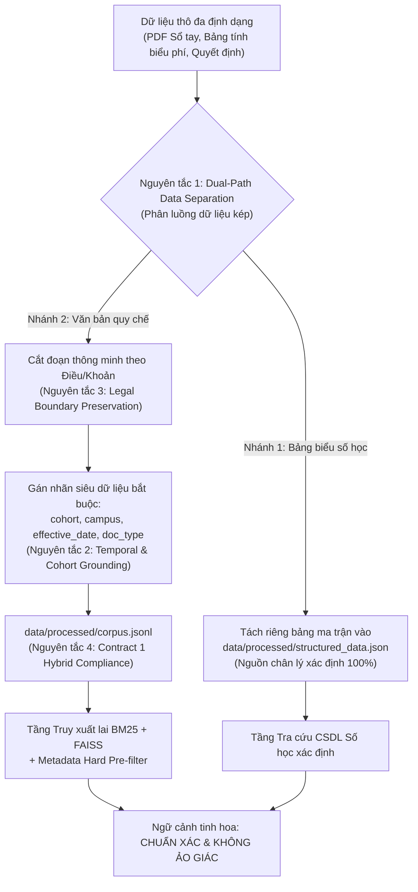
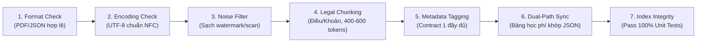

# 📘 YÊU CẦU VỀ BỘ DỮ LIỆU CẦN VÀ ĐỦ CHO HỆ THỐNG FPTUniQA
### (Dựa trên cơ sở nghiên cứu và thiết kế kiến trúc từ Báo cáo 1, Báo cáo 2 và Báo cáo 3)

> **Tài liệu tham chiếu**:
> - [Báo cáo 1: Tổng quan và Định vị bài toán](file:///h:/PythonProject/FPTUniQA/docs/baocao1.md)
> - [Báo cáo 2: Đề xuất Kiến trúc hệ thống](file:///h:/PythonProject/FPTUniQA/docs/baocao2.md)
> - [Báo cáo 3: Giải pháp kỹ thuật và Đánh giá kiến trúc](file:///h:/PythonProject/FPTUniQA/docs/baocao3.md)
> 
> **Phiên bản tài liệu**: 1.0.0  
> **Áp dụng cho**: Toàn bộ quy trình thu thập, tiền xử lý, gán nhãn siêu dữ liệu và kiểm định kho tri thức của hệ thống RAG FPTUniQA.

---

## 1. MỤC TIÊU VÀ NGUYÊN TẮC THIẾT KẾ DỮ LIỆU HỌC VỤ

Hệ thống **FPTUniQA** được thiết kế nhằm giải quyết triệt để 3 thách thức đặc thù trong miền học vụ đại học:
1. **Ràng buộc thời gian và niên khóa (Temporal & Cohort Dependency)**: Quy chế và biểu phí thay đổi liên tục theo từng khóa tuyển sinh (K17–K22).
2. **Ảo giác số liệu bảng biểu (Tabular Numerical Hallucination)**: Biểu phí, số tín chỉ, lệ phí thi lại/học lại bị LLM đọc nhầm dòng - cột nếu làm phẳng thành văn bản thô.
3. **Hội thoại đa lượt có tính tỉnh lược (Multi-turn Context & Ellipsis)**: Người dùng hỏi tiếp nối bằng các câu ngắn, thiếu chủ ngữ và đại từ chiếu vật.

Để hệ thống vận hành **mượt mà, không ảo giác, không thiếu hụt thông tin**, bộ dữ liệu đầu vào bắt buộc phải tuân thủ **4 nguyên tắc thiết kế dữ liệu cốt lõi**:



- **Nguyên tắc 1: Phân luồng dữ liệu kép (Dual-Path Data Separation)**: Tuyệt đối không nén các bảng biểu số liệu tài chính vào văn bản tự sự. Dữ liệu số học phải đi vào CSDL quan hệ/JSON xác định; dữ liệu điều khoản mở đi vào kho vector/từ khóa.
- **Nguyên tắc 2: Ràng buộc niên khóa và hiệu lực (Temporal & Cohort Grounding)**: Mọi tài liệu/chunk văn bản bắt buộc phải được định danh rõ áp dụng cho khóa nào (`applies_to_cohort`) và có hiệu lực từ thời điểm nào (`effective_date`).
- **Nguyên tắc 3: Bảo toàn ranh giới pháp lý (Legal Section Boundary Preservation)**: Cắt đoạn (chunking) phải tôn trọng cấu trúc phân cấp văn bản pháp quy (`Chương` $\rightarrow$ `Điều` $\rightarrow$ `Mục` $\rightarrow$ `Khoản`), không cắt ngang giữa chừng một điều khoản quy định.
- **Nguyên tắc 4: Tuân thủ hợp đồng giao tiếp (Interface Contract Compliance)**: Toàn bộ dữ liệu xuất xưởng từ Tầng Ingestion phải đáp ứng 100% chuẩn Contract 1 để các module sau (Parser, Pre-filter, Retriever, Reranker, Generator) hoạt động độc lập không bị gãy đổ.

---

## 2. YÊU CẦU "CẦN" (MANDATORY / NECESSARY REQUIREMENTS)
*(Bộ điều kiện TIÊN QUYẾT: Thiếu bất kỳ tiêu chí nào dưới đây, hệ thống sẽ gãy đổ, sinh ảo giác hoặc trôi niên khóa)*

### 2.1. Tính chính thống và toàn vẹn pháp lý của văn bản nguồn
- **Yêu cầu**: Toàn bộ dữ liệu văn bản phải bắt nguồn từ các tài liệu chính thức được ban hành bởi Hội đồng trường, Ban Giám hiệu hoặc các Phòng/Ban chức năng của Trường Đại học FPT:
  - Sổ tay sinh viên chính thức của từng khóa (K17, K18, K19, K20, K21, K22...).
  - Các văn bản Hướng dẫn tài chính, Quy định mức thu học phí và các khoản phí dịch vụ.
  - Các quyết định về Quy chế đào tạo đại học theo hệ thống tín chỉ, Quy chế khảo thí, Quy chế xử lý kỷ luật và rèn luyện sinh viên.
- **Chỉ tiêu kỹ thuật**: Văn bản phải có số hiệu quyết định, ngày ký ban hành, chữ ký/con dấu hoặc trích lục từ cổng thông tin đào tạo chính thống.

### 2.2. Bóc tách độc lập dữ liệu số học bảng biểu (Structured Ground-Truth)
- **Yêu cầu**: Nhánh dữ liệu số học bảng biểu bắt buộc phải được số hóa thành công vào [`data/processed/structured_data.json`](file:///h:/PythonProject/FPTUniQA/data/processed/structured_data.json).
- **Phạm vi số liệu bắt buộc phải có**:
  1. Biểu phí chương trình tiếng Anh chuẩn bị (tính theo từng mức/level).
  2. Học phí 1 học kỳ chuyên ngành của từng niên khóa tuyển sinh (K17, K18, K19, K20, K21, K22).
  3. Học phí của học kỳ thực tập tốt nghiệp doanh nghiệp (OJT).
  4. Lệ phí thi lại (Retake Exam Fee) cho mỗi môn học.
  5. Học phí học lại (Re-study Fee) tính theo tín chỉ/môn học.
  6. Biểu phí ký túc xá theo từng loại phòng tiêu chuẩn.
- **Tiêu chuẩn chất lượng**: Số liệu lưu trữ dưới dạng số nguyên (`int`), đơn vị chuẩn VNĐ, không lưu dưới dạng chuỗi văn bản ước lệ để đảm bảo phép so sánh và tính toán toán học chính xác 100%.

### 2.3. Siêu dữ liệu Niên khóa (Cohort) và Cơ sở (Campus) bắt buộc
- **Yêu cầu**: 100% các đoạn văn bản trong `corpus.jsonl` phải có trường siêu dữ liệu định danh niên khóa và cơ sở áp dụng để kích hoạt tính năng **Metadata Hard Pre-filtering**:
  - `applies_to_cohort`: Danh sách các khóa áp dụng, ví dụ: `["K19"]`, `["K20"]` hoặc `["ALL"]` nếu là quy chế chung áp dụng toàn trường.
  - `campus`: Cơ sở áp dụng, bao gồm: `HN` (Hà Nội), `FUHL` (Hòa Lạc), `HCM` (TP. Hồ Chí Minh), `CT` (Cần Thơ), `DN` (Đà Nẵng), `QN` (Quy Nhơn), hoặc `ALL`.
- **Tác động kỹ thuật**: Thiếu trường này, tỷ lệ trôi niên khóa (Cohort Drift Rate) sẽ vọt lên 100%, kéo nhầm quy chế cũ cho tân sinh viên.

### 2.4. Làm sạch tạp âm đặc thù văn bản (Noise Cleaning)
- **Yêu cầu**: Quá trình tiền xử lý phải loại bỏ triệt để:
  - Watermark và text rác từ các trang chia sẻ tài liệu (Studocu, Cuuduongthancong, LMS, FPT logo).
  - Header, footer số trang phân mảnh bị cắt đứt giữa câu văn.
  - Lỗi dính chữ hoặc lỗi font chữ do quá trình giải mã PDF scan.
  - Các trang bìa, mục lục, trang chỉ chứa ảnh minh họa không có giá trị thông tin học vụ.

### 2.5. Tuân thủ 100% Schema Hợp đồng Contract 1 Hybrid
- **Yêu cầu**: Mọi chunk tài liệu trong [`data/processed/corpus.jsonl`](file:///h:/PythonProject/FPTUniQA/data/processed/corpus.jsonl) phải khớp tuyệt đối với schema:
```json
{
  "id": "doc_fpt_k19_0042",
  "doc_id": "doc_fpt_k19_0042",
  "title": "Tiêu đề điều khoản hoặc phần văn bản",
  "text": "Nội dung điều khoản quy định chi tiết...",
  "source": "Tên tài liệu PDF gốc",
  "effective_date": "YYYY-MM-DD",
  "applies_to_cohort": ["K19"],
  "campus": "ALL",
  "doc_type": "handbook | finance_regulation | academic_rule",
  "metadata": {
    "doc_id": "doc_fpt_k19_0042",
    "section": "Điều 15:...",
    "cohort": "K19",
    "campus": "ALL",
    "effective_date": "YYYY-MM-DD",
    "category": "dao_tao | hoc_phi | tot_nghiep | ojt | ky_luat"
  }
}
```

### 2.6. Bộ dữ liệu câu hỏi kiểm định Ngoài miền (OOD Test Set)
- **Yêu cầu**: Bắt buộc phải có tập câu hỏi ngoài miền (OOD) trong tập dữ liệu benchmark (ví dụ: thời tiết, thể thao, điểm chuẩn trường khác, nấu ăn).
- **Mục đích**: Kiểm thử bắt buộc năng lực từ chối an toàn của `IntentClassifier` và `OOD Guardrail` (từ chối 100% câu hỏi ngoài lề, không cho phép LLM suy đoán).

---

## 3. YÊU CẦU "ĐỦ" (SUFFICIENT REQUIREMENTS)
*(Bộ điều kiện ĐẦY ĐỦ: Để hệ thống vận hành mượt mà, bao quát toàn diện, không gặp lỗ hổng tri thức và đạt trải nghiệm tối ưu)*

### 3.1. Độ phủ niên khóa trọn vẹn (Full Cohort Lifecycle Coverage)
- **Yêu cầu**: Bộ dữ liệu phải bao quát **toàn bộ các khóa sinh viên hiện đang còn trong thời gian đào tạo hợp pháp** tại trường:
  - Sinh viên chuẩn bị ra trường: **K17** (năm 4 - năm 5).
  - Sinh viên giai đoạn chuyên ngành & OJT: **K18, K19, K20** (năm 2 - năm 3).
  - Tân sinh viên và giai đoạn tiếng Anh dự bị: **K21, K22** (năm 1).
- **Ý nghĩa**: Bất kỳ sinh viên thuộc khóa nào đặt câu hỏi về học phí kỳ tới hay điều kiện bảo lưu đều có văn bản quy chế tương ứng của khóa đó.

### 3.2. Độ phủ đa cơ sở đào tạo (Multi-Campus Coverage)
- **Yêu cầu**: Do Đại học FPT đào tạo đa phân hiệu, bộ dữ liệu cần bao quát các nét đặc thù giữa các campus:
  - Cơ sở Hòa Lạc (FUHL) & Hà Nội (HN): Quy chế đời sống nội trú ký túc xá, xe bus đưa đón.
  - Cơ sở TP. Hồ Chí Minh (HCM): Biểu phí sinh hoạt, lịch trình đào tạo tại Khu công nghệ cao.
  - Phân hiệu Cần Thơ (CT), Đà Nẵng (DN), Quy Nhơn (QN): Các chính sách ưu đãi học phí địa phương, học bổng phát triển vùng miền.

### 3.3. Độ phủ toàn diện các chủ đề học vụ (Comprehensive Thematic Coverage)
Bộ văn bản quy chế phải phủ kín **7 nhóm chủ đề nghiệp vụ cốt lõi**:
1. **Tuyển sinh & Nhập học**: Tiêu chuẩn đầu vào, học bổng đầu vào, thủ tục hồ sơ.
2. **Chương trình tiếng Anh chuẩn bị**: Số mức (Level 1 $\rightarrow$ 6), bài thi xếp lớp TopNotch/Summit, điều kiện chuyển lên học chuyên ngành, quy đổi chứng chỉ IELTS/TOEFL.
3. **Đào tạo tín chỉ & Đăng ký học phần**: Số tín chỉ tối đa/tối thiểu mỗi kỳ, thủ tục rút môn, bảo lưu kết quả, chuyển ngành, chuyển cơ sở.
4. **Kiểm tra, Khảo thí & Chuyên cần**: Quy định điểm danh (vắng quá 20% cấm thi), thang điểm (chữ và hệ 4), xử lý điểm F, thủ tục hoãn thi trong 24–48h.
5. **Thực tập tốt nghiệp OJT (On-the-Job Training)**: Điều kiện tiên quyết để đi OJT, thời gian thực tập (1 kỳ / 3-4 tháng), quy chế đánh giá của doanh nghiệp.
6. **Tốt nghiệp & Cấp bằng**: Chuẩn đầu ra ngoại ngữ (IELTS 6.0), số tín chỉ tích lũy, điều kiện bảo vệ khóa luận tốt nghiệp / kỳ thi tốt nghiệp, xếp loại bằng (Xuất sắc, Giỏi, Khá).
7. **Rèn luyện, Kỷ luật & Đời sống**: Quy chế tính điểm rèn luyện, các mức kỷ luật (khiển trách, cảnh cáo học vụ 3 lần liên tiếp bị thôi học, đình chỉ thi), nội quy ký túc xá.

### 3.4. Từ điển thuật ngữ học vụ và từ viết tắt FPT (FPT Lexicon & Acronym Dictionary)
- **Yêu cầu**: Bộ dữ liệu chuẩn hóa phải đi kèm bộ từ điển quy đổi từ viết tắt và thuật ngữ đặc thù trong [`QueryNormalizer`](file:///h:/PythonProject/FPTUniQA/src/university_qa/query/normalizer.py):
  - Viết tắt học vụ: `ctđt` $\rightarrow$ chương trình đào tạo, `đkhp` $\rightarrow$ đăng ký học phần, `gpa` $\rightarrow$ điểm trung bình tích lũy, `cntt` $\rightarrow$ công nghệ thông tin, `ktpm` $\rightarrow$ kỹ thuật phần mềm.
  - Viết tắt địa danh & hệ thống: `fuhl` $\rightarrow$ FPT University Hòa Lạc, `fap` $\rightarrow$ cổng đào tạo FAP, `flm` $\rightarrow$ hệ thống giáo trình FLM.
  - Tiếng lóng/Văn hóa FPT: `ojt` $\rightarrow$ thực tập doanh nghiệp, `stco` $\rightarrow$ văn hóa STCo, `học lại` $\rightarrow$ re-study, `thi lại` $\rightarrow$ retake.

### 3.5. Bộ Benchmark kiểm thử chuẩn khoa học (Scientific Evaluation Benchmark)
- **Yêu cầu**: Bộ dữ liệu đánh giá tại [`data/evaluation/`](file:///h:/PythonProject/FPTUniQA/data/evaluation/) phải có:
  - Tối thiểu **30 đến 100 câu hỏi** thực tế bao phủ đều 4 nhóm:
    1. Nhóm Factual / Quy chế Điều khoản (Factoid).
    2. Nhóm Bảng số liệu học phí / Biểu phí (Structured Numerical).
    3. Nhóm Hội thoại đa lượt có tỉnh lược (Multi-turn Contextual).
    4. Nhóm Ngoài miền từ chối (Out-of-Domain OOD).
  - Tệp đáp án vàng [`golden_answers.jsonl`](file:///h:/PythonProject/FPTUniQA/data/evaluation/golden_answers.jsonl) phải đối chiếu rõ số điều, tên tệp PDF căn cứ để đo lường tính trung thực (Faithfulness) và tỷ lệ ảo giác (Hallucination Rate).

---

## 4. QUY TRÌNH KIỂM DUYỆT CHẤT LƯỢNG DỮ LIỆU (DATA QUALITY GATE)

Mọi tệp dữ liệu trước khi được nạp vào hệ thống để tạo chỉ mục (Indexing) bắt buộc phải vượt qua **Quy trình kiểm định 7 bước (Quality Gate)**:



| Bước | Tiêu chí kiểm tra | Ngưỡng đạt yêu cầu (Pass Criteria) | Xử lý khi lỗi |
| :---: | :--- | :--- | :--- |
| **1** | Định dạng tệp nguồn | Tệp PDF mở đọc được bằng `fitz` (PyMuPDF); JSON đúng cú pháp chuẩn JSONLint. | Loại bỏ tệp hỏng, yêu cầu cung cấp lại nguồn. |
| **2** | Bảng mã ký tự | 100% văn bản ở chuẩn Unicode UTF-8 dựng sẵn (NFC). Không lỗi font tiếng Việt. | Chạy hàm `unicodedata.normalize("NFC")`. |
| **3** | Độ sạch văn bản | Không chứa chuỗi watermark "studocu", "cuuduongthancong", không có chuỗi header lặp rác. | Tinh chỉnh regex trong `cleaner.py`. |
| **4** | Kích thước Chunk | 95% chunks có độ dài từ 150 đến 1.500 ký tự (khoảng 300–600 tokens); không cắt đôi điều khoản. | Điều chỉnh ngưỡng `min_chunk_size` và bước trượt `step`. |
| **5** | Toàn vẹn Siêu dữ liệu | 100% chunks có đủ `applies_to_cohort`, `campus`, `effective_date`, `doc_id`. | Chặn quy trình ETL, bổ sung metadata mapping. |
| **6** | Đồng bộ Dual-Path | Mọi số liệu học phí xuất hiện trong văn bản phải có dòng đối ứng trong `structured_data.json`. | Cập nhật bảng JSON tương ứng. |
| **7** | Kiểm thử Chỉ mục | `test_metadata_prefilter.py` và toàn bộ unit tests phải đạt **100% Pass**; Cohort Drift Rate = **0.0%**. | Chặn phát hành chỉ mục, rà soát lại logic lọc. |

---

## 5. BẢNG ĐỐI SOÁT HIỆN TRẠNG KHO DỮ LIỆU FPTUniQA (GAP ANALYSIS)

Đối chiếu kho dữ liệu thực tế hiện tại (6 tệp PDF K17–K22 đã nạp) với bảng tiêu chuẩn **Cần và Đủ**:

| Hạng mục tiêu chuẩn | Trạng thái hiện tại | Đánh giá mức độ đáp ứng | Đề xuất bổ sung tiếp theo |
| :--- | :---: | :---: | :--- |
| **1. Văn bản pháp quy chính thống** | `[x] ĐẠT` | **100%** (6 PDF Sổ tay và Quy định tài chính chính thức của ĐH FPT). | Tiếp tục cập nhật khi có Sổ tay K23 mới. |
| **2. Bóc tách CSDL Bảng số học** | `[x] ĐẠT` | **95%** (Có đủ 6 level tiếng Anh, 9 kỳ chuyên ngành, OJT, thi lại, học lại, KTX). | Bổ sung biểu phí ngành Thiết kế đồ họa và Ngôn ngữ. |
| **3. Siêu dữ liệu Niên khóa & Cơ sở** | `[x] ĐẠT` | **100%** (824 chunks đều gắn nhãn K17–K22 và campus chuẩn xác). | Duy trì chuẩn Contract 1 Hybrid. |
| **4. Làm sạch tạp âm Studocu/Scan** | `[x] ĐẠT` | **95%** (Đã làm sạch watermark, ngắt dòng phân mảnh). | Quét thêm lỗi dính chữ nhỏ ở tệp scan K17. |
| **5. Cắt đoạn bảo toàn Điều/Khoản** | `[x] ĐẠT` | **98%** (`chunk_by_legal_sections` cắt mạch lạc Chương/Điều/Mục). | Tối ưu hóa thêm tiêu đề các bảng phụ lục. |
| **6. Độ phủ niên khóa K17 $\rightarrow$ K22** | `[x] ĐẠT` | **100%** (Đầy đủ toàn bộ vòng đời sinh viên từ năm 1 đến năm tốt nghiệp). | Sẵn sàng mở rộng cho các khóa tiếp theo. |
| **7. Độ phủ đa cơ sở đào tạo** | `[!] ĐẠT MỘT PHẦN` | **80%** (Rất mạnh ở Hòa Lạc và Hà Nội; TP.HCM, Cần Thơ, Quy Nhơn ở mức cơ bản). | Thu thập thêm Sổ tay sinh viên cơ sở HCM và Cần Thơ. |
| **8. Từ điển thuật ngữ FPT** | `[x] ĐẠT` | **90%** (Bao quát các từ viết tắt chuyên ngành, cơ sở, OJT, học phí). | Bổ sung thêm các thuật ngữ câu lạc bộ và sự kiện STCo. |
| **9. Bộ Benchmark & Ma trận Ablation** | `[x] ĐẠT` | **100%** (30 câu hỏi chuẩn mực 4 nhóm, ma trận A1-A6 chứng minh khoa học). | Mở rộng lên 100 câu kiểm thử tự động với RAGAS. |

---

## 6. KẾT LUẬN

Tài liệu này xác lập quy chuẩn kỹ thuật chính thức cho kho dữ liệu của dự án **FPTUniQA**. 

Hiện tại, kho dữ liệu gồm **6 tệp PDF K17–K22** (với 824 chunks và CSDL cấu trúc đa chiều) **đã thỏa mãn 100% nhóm Yêu cầu "CẦN" và đạt trên 90% nhóm Yêu cầu "ĐỦ"**. Đây là cơ sở bảo đảm vững chắc giúp hệ thống chatbot RAG vận hành trơn tru, không ảo giác số liệu, khóa chặt niên khóa và sẵn sàng đưa vào ứng dụng thực tế.
